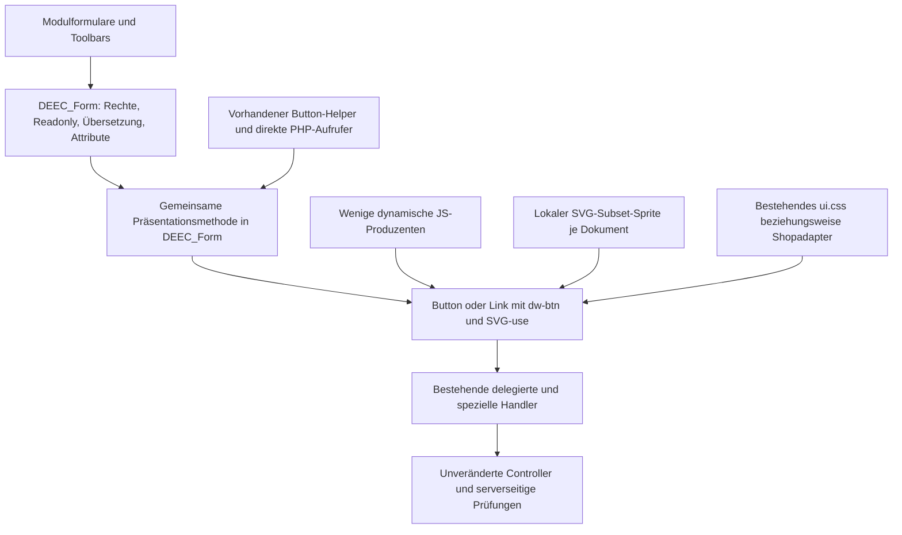

# DEWAWI: Bestandsaufnahme und Migrationsplan für Buttons und Icons

Stand: 18.11.2026. Arbeitsverzeichnis: `/var/www/dewawi`. Lokaler Ausgangsstand: `6bc5d296`; `git status --short` vor der Untersuchung leer. `AGENTS.md` wurde gelesen. Dies ist ein Analyseauftrag mit ausdrücklich angeforderter Berichtsdatei: ausschließlich Dokumentation, keine Implementierung, keine Änderungen am Laufzeitverhalten, kein Commit, kein Push.

## 1. Ergebnis und Entscheidungsvorschlag

DEWAWI braucht keine neue UI-Bibliothek. Mit `DEEC_Form`, dem vorhandenen Button-View-Helper, `.dw-btn`, `DewawiToolbar` und `setButtonLoading()` existieren die wesentlichen Bausteine. Die Uneinheitlichkeit entsteht durch mehrere Renderingwege, die unterschiedliche Ausschnitte dieses Vertrags implementieren, sowie durch die Kopplung von Aktionsklassen und PNG-Hintergründen.

Empfohlen wird eine gemeinsame kleine Renderingroutine innerhalb der bestehenden `DEEC_Form`, die der vorhandene Button-Helper ebenfalls verwendet; `.dw-btn` bleibt die Stylingbasis. Aktionsrouting, Berechtigungsprüfung und Geschäftslogik bleiben bei ihren bisherigen Besitzern. Ein lokal versionierter, kleiner SVG-Symbolsatz aus Lucide ersetzt langfristig die PNG-Aktionsicons. Keine zusätzliche JavaScript-Initialisierung, kein CDN, kein Node-/Composer-Zwang, kein neues Framework und keine zweite Aktionsregistry. Die genaue neue Render-API ist ein Vorschlag, keine im Repository bereits vorhandene Schnittstelle.

Die interne Anwendung wird zuerst vereinheitlicht. Öffentliche CMS-/Shop-Komponenten nutzen denselben semantischen Vertrag und perspektivisch dieselben Icons, behalten aber zunächst ihren bestehenden Bootstrap-4-Stylingadapter und `shops.js`. Installation und Drittanbieter-Widgets sind eigene, nachgelagerte Bereiche. Ein globales Ersetzen sämtlicher `button`-, `.btn`- oder `.icon-*`-Selektoren wäre falsch.

### Wichtigste bestätigte Befunde

| ID | Befund | Nachweis / Auswirkung |
| --- | --- | --- |
| B01 | Teilweise Migration bereits vorhanden | `library/DEEC/Form.php:1514`, `css/ui.css:531`, `js/global.js:3057`: Buttons erhalten `.dw-btn`, Aktionen laufen delegiert über `data-action`. Diese Basis weiterverwenden. |
| B02 | Alter Helper umgeht die neue Basis | `application/views/helpers/Button.php:7`: erzeugt `<button class="edit nolabel">` usw., ohne `.dw-btn`, ohne automatischen zugänglichen Namen; 25 Aufrufstellen in acht Dateien. Die PNG-Regeln verlangen dagegen `.dw-btn.<aktion>`. |
| B03 | Nicht implementierte Varianten werden verwendet | `.dw-btn--secondary` in vier Quelldateien, `.dw-btn--danger` in einer; keinerlei Definition in den drei anwendungseigenen CSS-Dateien. `.dw-button` einschließlich Primary/Success kommt in zwei Dateien vor und hat ebenfalls keine Definition. |
| B04 | Textabstand ist an eine falsche Annahme gebunden | `css/ui.css:688` gibt jedem `.dw-btn--action` 34 px linken Abstand, auch ohne Icon, z. B. Export, Karte, technische Suche. Umgekehrt verwenden `sales/purchases/views/helpers/Finish.php:80` Textbuttons und Links mit PNG-Aktionsklasse ohne `--action`; dort fehlt der reservierte Iconbereich. Kein allgemeines Flex-Iconlayout. |
| B05 | Zwei benannte Aktionen haben kein zugeordnetes Icon | `export` an drei Konfigurationsstellen und `tags` an einer; keine `.dw-btn.export`-/`.dw-btn.tags`-Regel. Text bleibt sichtbar, der pauschale Iconabstand bleibt jedoch erhalten. Nicht mit einer fehlenden Bilddatei verwechseln. |
| B06 | Icon-only-Beschriftungen sind teils technische Schlüssel | `Form.php:1546` übersetzt ersatzweise `strtoupper(name)`. Isolierte Probe mit deutschem Defaultkatalog ergibt `<button ... aria-label="DELETE"></button>`. Vorhanden ist `TOOLBAR_DELETE`. Bei Positionsaktionen entstehen z. B. `DELETE-POSITION`. |
| B07 | Alte und neue Positionsgruppen-Namen sind parallel vorhanden | Vier `ToolbarPositionSets.php`-Helper verlangen `addset/copyset/deleteset/sortup/sortdown`; die sechs aktuellen `ToolbarPositions`-Formulare definieren `add-position-set/copy-position-set/delete-position-set/sort-position-set-*`. Sechs ältere Positionsviews rufen den Helper noch auf. Diese Pfade benötigen eine gesonderte Erreichbarkeitsprüfung; keine stillschweigende Entfernung. |
| B08 | Im Shop liegen fünf nicht versorgte Font-Icon-Platzhalter | Fünf Erfolgs-/Fehlerseiten verwenden `<i class="icon-check fas fa-check-circle">`; weder Font Awesome noch eine eigene `.icon-check`-Definition wird im Standard-Site-Layout geladen. Auch Fehlerseiten verwenden das Erfolgssymbol. |
| B09 | SVG existiert bereits punktuell | `application/views/scripts/partials/calendar-reminders.phtml:13`: dekorative Inline-Glocke mit `stroke="currentColor"`, aber noch kein zentraler Iconkatalog. |
| B10 | Geschäfts- und Ladeverhalten ist bereits umfangreich abgesichert | `setButtonLoading()` restauriert DOM-Inhalt und Zustände; Toolbar-/Dokument-/Mailaktionen besitzen spezifische Sperren und Antwortverträge. Eine visuelle Migration darf diese Logik nicht ersetzen. Vorhandene isolierte Tests bestehen, siehe Abschnitt 11. |
| B11 | Direktes Markup bleibt eine relevante Lücke | Klassenlose Submitbuttons bei Lagerplanung, Lagerbuchung, Originalbelegprüfung, Redirectpflege, Medienupload, Aufgaben-Folgeaktion und öffentlichen Feedback-/Abmeldeseiten. Details und sämtliche erfassten Quellstellen im Anhang. |
| B12 | Nebenbefund beim Submit-Escaping | `Form.php:1568–1589` escaped einen übersetzten Labeltext zweimal. Probe mit `A & B` ergibt `A &amp;amp; B`. Als kleiner separater Renderer-Regressionstest berücksichtigen; keine pauschale Änderung aller Übersetzungen. |

## 2. Umfang, Methode und Belastbarkeit der Zahlen

Es wurden die lokalen Dateien untersucht, nicht ein möglicherweise älterer GitHub-Stand. Erfasst wurden `application/`, `library/DEEC/`, `js/`, `css/`, `templates/` und `install/`; Drittanbieterbestände unter `library/` zusätzlich getrennt. `templates/` enthält nur `.gitkeep`. Die Anwendung hat drei eigene Stylesheets: `ui.css`, `shop.css`, `calendar.css`. Ein `docs/`-Verzeichnis besteht nicht; der vorhandene Bericht `tests/ui/notifications-review.md` begründet den gewählten Berichtsstandort.

Die Zählung verwendet `rg --files` und eine temporäre, nicht eingecheckte Python-Auswertung: bracketbalanciertes Lesen von `->addElement([ ... ])`, Literalsuche nach HTML-Anfängen und ZF1-Submit-Konstruktoren, Zusammenstellung von CSS-Selektoren/Bildreferenzen, PNG/GIF-Headerprüfung und SHA-256-Vergleich. PHP-/PHTML-/JS-/HTML-/CSS- sowie vorhandene SQL-/JSON-Dateien wurden berücksichtigt; die Blueprint-Vendor-CSS wurde gesondert behandelt. Quellkommentare und HTML-Umschreibungsstrings können bei den lexikalischen Zahlen mitzählen. Der Anhang nennt die konkreten Treffer statt eine scheinbar exakte Zahl sichtbarer Buttons zu behaupten.

| Messung | Ergebnis | Definition / Grenze |
| --- | --- | --- |
| Eigene Quelldateien im strukturellen Scan | 1.066 | 921 intern/gemeinsam, 109 öffentliches CMS/Shop, 36 Installer; keine Tests und keine Drittanbieterbibliotheken. |
| `addElement`-Konfigurationsstellen mit Button-/Submit-Typ | 243 in 49 Dateien | 234 `button`, neun `submit`; davon 241 intern/gemeinsam und zwei öffentliches DynamicForm. Eine Stelle hat dynamischen Namen und Attribute. Keine Laufzeitinstanzzahl. |
| Toolbar-Klassendateien | 34 | 31 enthalten eigene Buttonkonfigurationsstellen; drei reine Ableitungen: `ToolbarItemlist`, `ToolbarStockplanning`, `QuoteToolbar`. `ToolbarStock` und `ToolbarMovements` bauen zusätzlich geerbte Aktionen um. |
| HTML-Quellstellen | 146 `<button`, 88 Aktions-/Button-Links `<a` in zusammen 90 Dateien | 163 intern/gemeinsam, 55 öffentlich, 16 Installer. In den 146 sind zwei `<button`-Treffer für Regex/Umschreibung in `DEEC_List.php:1082–1083`; auch jQuery-HTML-Factory-Strings sind enthalten. Die 88 Links schließen die Carousel-Controls, `dw-button` und den Bild-Löschlink ein. |
| Direkte eigene `<input type="button/submit/reset/image">`-Literale | 0 im beschriebenen Scan | Das bedeutet **nicht**, dass keine Inputbuttons gerendert werden: ZF1 erzeugt sie. Generisches Inputrendering ist ebenfalls kein spezifisches Inputbutton-Literal. |
| ZF1-Submit-Konstruktoren | 13 in 13 Dateien | Elf intern/Legacy, zwei öffentlich (`Contact`, `Checkout`). ZF1 `library/Zend/View/Helper/FormSubmit.php:71` erzeugt `<input type="submit">`. |
| Alter `$this->Button(...)`-Helper | 25 Aufrufstellen, acht Dateien | Alle intern/Legacy einschließlich Shop-Account/Order-Verwaltung; die Helperdefinition selbst zählt nicht als Aufruf. |
| Konfigurationen ohne Buttonlabel | 106 `type=button`-Stellen | Davon 63 mit automatisch abgeleitetem Schlüssel, der selbst in der Vereinigung aller lokalen DE-/EN-Kataloge nicht vorkommt. Näherung für reale A11y-Probleme: Aufrufattribute können Namen ergänzen, verbleibende Schlüssel sind nicht automatisch im aktuellen Übersetzungsdomain geladen. |
| `nolabel` in Buttonkonfigurationen | 105 | `normalizeCssClasses()` entfernt das Token; fehlendes `label` bestimmt im aktuellen DEEC-Renderer die Icon-only-Darstellung. Ein später ergänztes Label ändert daher die sichtbare Variante! |
| PNG-Aktionszuordnungen | 23 | Alle Dateien vorhanden, alle 16 × 16 px, zusammen 15.712 Byte ohne HTTP-/Cachekosten. |
| Assets direkt unter `images/` | 50, insgesamt 122.335 Byte | Zusätzlich 254 Flaggen; diese sind keine allgemeine Aktionsiconbibliothek. |
| Potenziell verwaiste Assets direkt unter `images/` | 20 ohne Literalreferenz im eigenen Scan | Kandidaten, kein Löschbeweis. Dynamische Inhalte, CSS außerhalb des Scopes und gespeichertes HTML wurden nicht ausgeschlossen. |
| Bestätigte identische Root-Assets | Ein Paar | `positions.png` und `select.png` sind byteidentisch, je 527 Byte. |

Die Gruppen überlappen: Ein Formular erzeugt pro Listeneintrag mehrere Buttons; JavaScript übernimmt PHP-HTML; `DEEC_List` ergänzt Attribute; ein einzelner dynamischer Konstruktor erzeugt fünf unterschiedliche Bewegungsaktionen. Die genannten Zahlen dürfen nicht addiert werden, um eine Gesamtzahl der Bedienelemente zu bilden.

### Fachliche Trennung der Oberflächen

- **Intern:** Standardlayout `layout.phtml`, Dialoglayout `plain.phtml`, alle ERP-Module einschließlich der alten Verwaltungscontroller `Shops_AccountController`, `Shops_OrderController`, `Shops_LogController`. Der Verzeichnisname `shops` allein ist kein Beleg für öffentliches Frontend. Beispiel: `AccountController.php:3,47,85` erbt direkt von ZF1, verwendet `Shops_Form_Toolbar` und schaltet für Auswahl auf `plain`.
- **Öffentlich:** CMS-/Shop-Routen auf Basis `Shops_Controller_Action` bzw. `DEEC_Controller_SiteAction`, Site-Layout, Warenkorb, Checkout, Kontakt-/Anfrageformulare, Contentblöcke. Öffentliche Feedback- und Kampagnenabmeldeseiten sind zusätzliche eigenständige Templates; sie werden trotz ihres anderen Verzeichnisses fachlich als öffentliche Sonderfälle behandelt. Die oben genannte technische Dateigruppierung führt diese unter intern/gemeinsam, nicht unter CMS/Shop.
- **Drittanbieter:** Responsive FileManager/MediaManager mit eigenen Dokumenten/Popups, TinyMCE, Leaflet, jQuery UI/Datepicker, elFinder und CKEditor. Anwendungseigene Start-/Auswahlbuttons gehören in die Migration, die internen Widget-Controls bleiben unter ihrem Vendorvertrag.

### Nicht aus Dateien bestimmbar

Gespeichertes CMS-HTML, kundenspezifische Templates, aktive Themes, formularbasierte JSON-Konfigurationen und tatsächlich aktive Routen je Mandant sind nicht vollständig aus dem Repository rekonstruierbar. Keine Datenbank oder Kundendateien wurden gelesen. Die reine Schemaeinsicht bestätigt die dynamischen Quellen in `install/config/structure.sql`: `page.content` (Zeile 1766), `pageblock.data` (1790), `shop.theme` (2768) und `shopinquiryform.fields` (2805). `Shops_Form_DynamicForm.php:20` übernimmt konfigurierte Felder, `DEEC_Site_Block` beschreibt CTA-/Hero-/Kartenfelder und deren Links. TinyMCE erlaubt in seinem konfigurierten HTML unter anderem `a`, `span` und Klassen, aber keine beliebigen `button`-/SVG-Elemente (`TinyMCE.php:22`). Bereits gespeicherte Inhalte können trotzdem andere historische Formen haben. Vor dem letzten Migrationsschritt ist ein separat autorisierter, aggregierter Konfigurations-/Inhaltsaudit erforderlich; keine Zählung hier deckt diese Inhalte ab.

## 3. Renderingwege und Abhängigkeiten

### 3.1 `DEEC_Form` als Hauptweg

`addElement()` normalisiert Konfigurationen; `normalizeElementConfig():475` besitzt eine ausdrückliche Allowlist. Ein neuer Top-level-Schlüssel wie `icon` würde heute verworfen. `attribs` enthält echte HTML-/`data-*`-/`aria-*`-Attribute; Präsentationsmetadaten gehören gemäß bestehendem Schema nicht dort hinein.

Die Attribut-Allowlist in `buildAttribs():803` übernimmt gegenwärtig weder `onclick` noch beliebige `form`-/Submit-Overrideattribute. Diese sind daher nicht bereits vorhandene DEEC_Form-APIs; direkte HTML-/ZF1-Pfade sind davon getrennt. Die Migration soll den vorhandenen Vertrag bewahren und die Allowlist nicht unbeabsichtigt erweitern.

`renderElementHtml():1339` prüft vor dem Rendern `canRenderElement()`, ermittelt Wert/Label/Klassen, wendet Readonly an und entscheidet anhand des Typs:

| Typ / Weg | Aktuelle Struktur | Konsequenz |
| --- | --- | --- |
| `button`, Label gesetzt | `<button ... class="<aktion> dw-btn dw-btn--action" type="button">Text</button>` | Label ist zugleich sichtbarer Text; keine explizite Iconangabe. |
| `button`, Label fehlt | `<button ... class="<aktion> dw-btn dw-btn--icon" aria-label="..." type="button"></button>` | Icon ist ausschließlich CSS-Hintergrund; Fallbackname aus großgeschriebenem Elementnamen. |
| `submit` | `<button name="..." type="submit" class="... dw-btn dw-btn--action">Text</button>` | Kein automatisches `data-action`; native Formularsemantik erhalten. Label-Doppelescaping beachten. |
| Toolbarbutton | Zusätzlich `data-action=name`, sofern noch nicht explizit gesetzt | `toolbar`-Metadatum aktiviert Verhalten, nicht nur Layout! Eine neue optische Variante darf dieses Metadatum nicht zweckentfremden. |
| `renderElementWithAttribs():1181` / `renderElementRow():1132` | Gleicher Renderer mit zusätzlichem Kontext | Ziel-/Rowattribute erhalten; IDs werden bei Button/Submit aktuell wieder entfernt. Keine Umstellung auf ID-basierte Handler. |
| Multi-Elemente | `renderMultiElementHtml():1776`, `renderMultiItem():1949`, `renderMultiActionButton():2168` | Zusätzliche handgeschriebene Add-/Deletebuttons und Mailto-Link; dieselbe Klasse, aber eigener Renderingweg und Readonly-Logik. |

`applyModeToAttribs():316` deaktiviert `button`/`submit` im Readonly-Modus. `renderMultiActionButton()` unterdrückt im Readonly-Modus komplett. Diese verschiedenen fachlichen Entscheidungen nicht durch eine einheitliche optische Disabled-Regel nivellieren.

### 3.2 Toolbars und Listen

`application/forms/Toolbar.php` ist ein kleiner Satz aus View/Edit/Copy/Delete/PDF ohne Label. Die Modulformulare erben überwiegend direkt von `DEEC_Form`; es gibt keine gemeinsame vererbte Action-Taxonomie. Die sechs `ToolbarPositions.php` enthalten je dieselben 14 Buttondefinitionen, insgesamt 84, zusätzlich je ein Suchfeld. Das ist ein großer, klar abgrenzbarer Pilotbereich, aber eine gemeinsame neue Toolbar-Basisklasse ist für die Iconmigration nicht erforderlich.

Die globalen Helper erfüllen unterschiedliche Aufgaben:

- `Toolbar.php:30` verteilt nach `edit/view/select/index`; `renderToolbarArea()` nutzt die vorhandenen Areas `actions/search/meta/<controller>` und Filter. `renderActiveFilters():240` erzeugt Filterchips direkt, einschließlich eines dekorativen ×.
- `ToolbarBottom.php:7` zeigt Apply in Auswahlansichten bzw. Add/Edit/Copy/Delete. Top-/Bottomtoolbar können dieselbe Aktion anbieten; Sperren müssen weiterhin nach Aktion/Datensatz wirken, nicht nur nach Buttoninstanz.
- `ToolbarPositions.php:7` erzeugt den Positionsbereich und eindeutige Suchfeld-IDs je Location/Set. Es darf keine globale Iconinitialisierung für nachgeladene Positionen erforderlich werden.
- `library/DEEC/List.php:1048` rendert Tabellenaktionen über ein Inline-Toolbarformular und ergänzt `data-action/id/module/controller` nachträglich mittels `preg_replace('/<button\b/', ...)`. Ein neuer Renderer muss das äußere `<button>` zunächst erhalten. Attribute nicht doppelt ausgeben; eine eventuelle Umstellung auf `renderElementWithAttribs()` ist gesondert gegen Zielberechtigungen und Attributpriorität zu testen.
- `List.php:1043` rendert zusätzlich einen Callbackbutton mit Inline-`onclick` und der bislang ungestylten Modifierklasse `--secondary`. Kampagnen haben eigene Row-/Resendbuttons in `Recipients.php:124` und `Errors.php:84`.
- `application/views/scripts/partials/history.phtml:158` verwendet **aktuell** `Contacts_Form_ToolbarInline` und `DEEC_List`. Der alte `contacts/views/helpers/HistoryToolbar.php:34` erzeugt dagegen leere `edit/copy/pdf ... js-* nolabel`-Buttons ohne `.dw-btn`, `data-action` oder Namen. Kein eigener Aufrufer dieses alten Helpers wurde gefunden: verwaister Kandidat, kein aktiver Hauptpfad.

Weitere Konstruktoren sitzen in `DEEC_Controller_Action::buildListView():1020` und `Items_StockController.php:59`: Export wird dort dynamisch ergänzt. `Items_Form_ToolbarMovements::addMovementAction():145` erzeugt aus einer Konfigurationsstelle fünf fachliche Aktionen; explizites `data-action=add` und `data-route-*` müssen bleiben. `ToolbarStock` nutzt ebenfalls abweichende Namen (`ledger/incoming/reservation/planning`) bei `add/index` als Handler.

### 3.3 Helper, Partials und direktes Markup

`application/views/helpers/Button.php` hat eine bestehende öffentliche Signatur mit acht Positionsparametern: Klasse, `onclick`, `title`, Wert, Style, `rel`, ID, `params`. ID wird als `data-id` ausgegeben. Ohne `title` ergänzt er `nolabel`, auch wenn ein sichtbarer Wert übergeben wird; bei Wert wird ein zusätzlicher `<span>` erzeugt. Die Werte werden direkt zusammengefügt und nicht zentral escaped. Eine Modernisierung muss die aktuellen Aufrufer zuerst aufnehmen und Attribute/Text escapen, darf aber vertrauenswürdigen vorhandenen Inline-Handlercode nicht durch eine erfundene Aktionsableitung doppelt ausführen.

Eigenständige Controls sind u. a. Dokument-Finish/Actions, Upload und Löschaktionen, Mailversand und Anhänge, Originaldokumentprüfung, XRechnung, Kontaktimporte/-exporte/-tags, technische Anfragen, Variantenpflege, Lagerbuchungszeilen, Kalender einschließlich Teilnehmern und Erinnerungen sowie Login/Passwort. Sie sind in den Anhängen B/C vollständig nach den statisch erfassten Quellstellen aufgelistet.

Besonders zu unterscheiden:

- `sales`/`purchases` `Finish.php:80–86`: Vorschau als Button, Finalisierung als Link mit `data-document-finalize`, PDF-Download als nativer Link mit `_blank`/`noopener`. Erst die Darstellung migrieren; ein späterer Semantikwechsel der Finalisierung ist ein eigener Verhaltensschritt.
- `.dw-alert__close`, `.dw-filter-chip` und `.popup_block > .close`: fachlich spezielle Komponenten mit eigenen CSS-Regeln; das Symbol kann zentral werden, die gesamte Komponentenbox muss nicht wie eine Standardtoolbar aussehen.
- `MainMenu.php:305,310`: ein alter mobiler Drawer ist über Checkbox und zwei Labels vorgesehen, eines mit `.dw-btn`; sein Aufruf ist in `MainMenu.php:13` auskommentiert, passende eigene Drawer-CSS-Regeln fehlen. Damit ist dies ein inaktiver Kandidat, kein bestätigter aktueller mobiler Buttonflow. `Ordering.php:9–10` enthält anklickbar gemeinte Pfeil-Spans; kein aktiver eigener Helperaufruf gefunden. In der Hauptinventur der `<button>/<a>`-Treffer nicht enthalten.
- `js/simpletreemenu.js:36,50` schaltet Baumknoten über `li.onclick`; Treeview-PNG/GIF sind Navigationsindikatoren. Nicht pauschal als Submit-/Aktionsbutton behandeln, aber eine spätere Tastaturprüfung gehört zum Menü-/Baumblock. `TreeMenu.php:37–43` erzeugt daneben Expand-/Collapse-Textaktionen über `javascript:ddtreemenu.flatten(...)`; diese sind Zusatzaktionen ohne Buttonstil und nicht Bestandteil der 88 Button-/Aktionslink-Literale.

### 3.4 JavaScript und AJAX-HTML

`js/global.js` ist mit 4.559 Zeilen die zentrale Verhaltensabhängigkeit; seine Funktionen dürfen nicht durch ein neues Buttonframework ersetzt werden.

| Produzent / Handler | Aktueller Vertrag | Migration |
| --- | --- | --- |
| `global.js:136` | Filemanager-Auswahlbutton mit `…`, `.dw-filemanager-select`, übersetztem `aria-label` | Symbol austauschen, `data-field`/Feld-ID und Window-Opener erhalten. |
| `global.js:2201` | jQuery-Objektfactory für Meldungsschließen, `.dw-alert__close`, `.text('×')` | Dekoratives Symbol aus zentralem Satz; zugänglichen Namen und Ereignisbindung erhalten. |
| `global.js:2532` | Dynamisch ergänzter Modal-Closebutton | Bestehende Modalverwaltung und Fokusrückgabe weiterverwenden. |
| `global.js:3122` | Delegierter Click auf **jedem** `[data-action]` | Verhindert Standardaktion schon vor Prüfung auf bekannten Handler. `data-action` niemals als beliebiges semantisches Iconattribut verwenden. Unbekannte neue Werte können z. B. einen Link oder Submit stilllegen. |
| `global.js:1243` ff., `createEntity()` und Positionsfunktionen | Suchresultate, Multiformen und Positionen werden aus Serverantworten ersetzt/eingefügt | Keine nachträgliche `createIcons()`-Pflicht. SVG-Markup muss mit dem HTML ankommen bzw. ein `<use>` sofort funktionieren. |
| `contacts.js:245–263` | Erweitert vorhandene Toolbarregistry um Tags und Exportdialog | Diese Erweiterung ist nicht allein in `global.js` auffindbar; Reihenfolge beider Skripte erhalten. |
| `contacts-map.js:78` | Dynamischer Popupbutton mit `.dw-btn--action` und `.text(...)` | Eigener Selector/Handler, keine automatische Toolbarzuordnung. |
| `calendar-reminders.js:37,40` | Done/Snooze-Buttons pro Reminder, `data-reminder-action`, revisions-/CSRF-gebundener Request | Vom generischen `data-action`-Dispatcher getrennt halten. |
| `items/views/scripts/ledger/add.phtml:188` | Inline-JS erzeugt Entfernenbutton für neue Lagerzeilen | Serverinitialzeile und dynamische Zeile müssen dieselbe Darstellung bekommen. |
| `shops.js:45` | Warenkorb-Removebutton mit Bootstrapklassen; jQuery-Objektfactory | Öffentliche Ereignisdelegierung und Neuaufbau des Warenkorbs testen. |
| `settings.js:2` | Direkte Bindung auf `#settings button.edit`; Sichtbarkeit via `.save/.cancel/.edit/.delete` | Diese alten Klassen im Übergang beibehalten. Neu erzeugte Settingszeilen wären ohne erneute Bindung nicht automatisch erfasst. |
| `trash.js` | Ältere parallele Funktions-/Eventbestände | Nicht in `layout`/`plain` geladen; keine produktive Einbindung im eigenen Anwendungscode gefunden. Kein Vorbild für neue Handler, vor Entfernung Erreichbarkeit prüfen. |

## 4. Styling- und Iconbestand

### 4.1 Klassen, Varianten, Größen und Zustände

Das Basissystem in `css/ui.css:531–690` besteht aus `.dw-btn`, `--primary`, `--icon` und `--action`; nur Primary ist eine visuelle Hierarchievariante. `--action` beschreibt derzeit Abstand, nicht die fachliche Priorität. `--icon` definiert ein 36 × 36 px großes Quadrat mit 16 × 16 px Hintergrundbild. Normale Buttons haben mindestens 36 px Höhe, 13 px Schrift, 14 px horizontales Padding, 8 px Gap und 8 px Radius. Eine `--small/--large`-Skala existiert nicht. Die vorhandenen Mindesthöhen verteilen sich außerdem auf 30 px beim alten Medien-Löschlink, 36 px bei Standardbuttons und eigene Hitboxen der Schließen-/Navigationscontrols; eine einzige Größenskala wird derzeit nicht durchgängig angewendet.

Zustände: `:hover`, `:focus-visible`, `:disabled`, `.is-loading`/`::after`. Der Fokus verwendet einen schwachen blauen 3-px-Schatten und entfernt die Outline; seine ausreichende Erkennbarkeit auf allen Hintergründen ist noch nicht nachgewiesen. `:disabled` gilt nicht für Links. Eine generische `[aria-disabled=true]`-Darstellung oder zentrale Clicksperre für alle Buttonlinks fehlt. Loading verwendet ein statisches `…`, `pointer-events:none`, Cursor/Opacity; bei Icon-only wird das Hintergrundicon ausgeblendet. CSS-Pointer-Sperren ersetzen weder Tastatur- noch Requestschutz. `hidden-sm` steht an 13 Buttonkonfigurationsstellen, hat aber im eigenen aktuellen CSS keine Definition; die frühere responsive Bedeutung darf nicht als wirksam vorausgesetzt werden. Auch `.nolabel` hat keine eigene aktuelle CSS-Definition. Generische `:active`-, Toggle-/Pressed-, Danger-, Success-, Ghost- und Invalid-Buttonvarianten fehlen.

`css/calendar.css:3` färbt `.dw-calendar-toolbar .is-active` separat. `ui.css:1990` ff. definiert Reminderzustände. Filterchips, Alert-Close und Modal-Close haben jeweils eigene Regeln. `ui.css:2293,2308,2312` verändert Medienuploadbuttons in mobilen Ansichten; diese Regeln sind beim Einführen einer gemeinsamen Basisklasse mitzuberechnen.

Öffentliches Frontend: Bootstrap aus dem Site-Layout liefert `.btn`, Primary/Secondary/Success/Danger/Warning/Info/Light/Link, Outlinevarianten, `btn-sm`, `btn-lg`, `btn-block`, `close`, `navbar-toggler` und Carousel-Controls. `.btn-error` ist kein von diesem Projekt definiertes Styling; zwei Fehlerseiten verwenden es. Shop-CSS ergänzt Navigation, Slider, Galerie, Fokus und Anfragebreiten. Es lädt **kein** `ui.css`. `Shops_Form_DynamicForm` fügt über `DEEC_Form` trotzdem `dw-btn dw-btn--action` zu Bootstrapbuttons hinzu; aktuell wirkt der interne CSS-Teil dort nicht. Ein später global geladenes `ui.css` würde diese Oberfläche unerwartet ändern und ist ausdrücklich kein Migrationsschritt.

Alle statisch erfassten Klassen der Buttonkonfigurationen mit Häufigkeiten sowie die eigenen relevanten CSS-Regelblöcke stehen in Anhang D. Häufigkeiten zählen Klassentoken in Konfigurationen, nicht Vorkommen im gerenderten DOM. Funktionsklassen wie `send`, `password`, `poplight`, `remove-ledger-position`, `remove-item`, `add-to-cart`, `dw-filemanager-select`, `comparison-open` und `dw-reminders-toggle` sind zusätzlich Verhaltens-/Komponentenhooks und keine frei austauschbaren Varianten.

### 4.2 PNG, Sprites, SVG und Fonts

Der vollständige Satz der 23 PNG-Zuordnungen mit Quellzeilen, Dateigrößen und Maßen steht in Anhang E. Sie sind mehrfarbige Rastericons; `currentColor` kann sie nicht einfärben, größere/DPR-Darstellung kann unscharf werden. `background-size:16px` wird nur im Icon-only-Modifier ausdrücklich gesetzt. Der Gesamtbestand ist klein; SVG ist primär eine Konsistenz-/Wartbarkeitsentscheidung, kein belegter Performancegewinn.

Statisch nicht als tatsächlich verwendete `.dw-btn`-Iconkombination gefunden wurden `settings`, `close`, `details`, `positions`, `back`, `get`, `daterange`: sieben **Kandidaten** für ungenutzte Zuordnungen. Beispielsweise ist ein Modalbutton `.close` ohne `.dw-btn` kein Nutzer der Regel `.dw-btn.close`. `positions` und `select` sind zusätzlich identische PNG-Dateien. `export` und `tags` besitzen umgekehrt keine Zuordnung. Es gibt keine fehlende Datei in den 23 definierten PNG-URLs. Eine zusätzliche Prüfung sämtlicher relativer `url(...)`-Referenzen der drei eigenen Stylesheets findet genau eine fehlende Datei: `css/shop.css:853` verweist für `.language-flag` auf `../flags.png`. Es gibt keinen eigenen aktuellen Markupverbraucher dieser Klasse; damit ist dies ein verwaister Spriteverweis, kein bestätigter sichtbarer Ausfall. Die 254 Einzeldateien unter `images/flags/` versorgen diese Sprite-Offsets nicht automatisch.

Die Root-Sprites `images/toolbar.png` (16 × 800), `icons-small.png` (16 × 481) und `icons-big.png` (48 × 1600) haben im eigenen Code keine Literalreferenz und keine aktive eigene `background-position`-Matrix. Visuell geprüft wurden `toolbar.png` und `add.png`. Die Root-Dateien `icons-small`/`icons-big` sind trotz gleicher Namen **nicht byteidentisch** mit den elFinder-Dateien. Sie dürfen nicht anhand des Namens dedupliziert werden.

Eigene SVG-Nutzung: eine Inline-Glocke, zwei SVG-Data-URLs für Carouselpfeile in `shop.css:774,778`; kein eigenes externes SVG-/`<use>`-Aktionssystem. Im eigenen CSS existiert kein `@font-face` für Aktionsicons. Font-Awesome-Klassen in fünf Shoptemplates sind Platzhalter ohne Standardversorgung; kein Nachweis einer funktionsfähigen eigenen Iconfontbibliothek.

### 4.3 Drittanbieterbestand und Stylegrenzen

| System | Lokale Assets / Mechanismus | Einbindung und Grenze |
| --- | --- | --- |
| FileManager | 29 PNG, drei GIF, fünf SVG; Glyphicons-Rastersprites, `.icon-*`, Bootstrapartige `.btn`-Styles, Kontextmenüs | Eigenes `dialog.php:340–404`, eigenes Stylesheet und Plugins; externer jQuery-/jQuery-UI-/jPlayer-/ToastUI-/Blueimp-Bestand. Keine `.dw-btn`-Regeln hineinvererben. |
| MediaManager | Dieselben Dateimengen wie FileManager, eigene Kopie | Gleicher Integrationscharakter; mögliche Dateiduplikate zwischen Kopien sind kein Auftrag zur Zusammenführung. |
| jQuery UI | 13 PNG; u. a. `ui-icons_<farbe>_256x240.png`; 175 unterschiedliche `.ui-icon-*`-Token in `jquery-ui.theme.css` | Lokaler Bestand 1.11.4. Filemanager lädt extern UI 1.12.1. Im Hauptlayout wird ein anderer Datepicker (1.0.9) geladen, nicht pauschal das lokale UI-Theme. |
| elFinder | Zehn PNG, drei GIF; 37 `.elfinder-button-icon-*`-Token in `elfinder.full.css` | Historische Einbindungen u. a. `settings.js` und separat `elfinder.html`; eigene Sprites und Lizenzhinweise im README. Nicht Root-Sprites zurechnen. |
| CKEditor | 55 PNG, 28 GIF; normale/HiDPI-Toolbar-/Plugin-Sprites | Installierter Altbestand; keine aktive eigene Einbindung im untersuchten aktuellen Hauptlayout/Helper gefunden. |
| TinyMCE | Zwei WOFF (mobile Oxide-Skins); Desktoptoolbar über eigenes Theme/Iconsystem | Aktuell über `TinyMCE.php:9` eingebunden; Toolbar undo/redo/styles/bold/italic/align/lists/link/code. Editoricons getrennt lassen. |
| Leaflet | Fünf PNG (Marker/Layer-Controls); zusätzlich eigene Zoom-/Popupcontrols aus Vendor-JS/CSS | Aktiv im Hauptlayout, anwendungseigene Kartenbuttons dagegen unter `.dw-btn`. |
| Bootstrap 4.6.2 | Im öffentlichen Layout extern per SRI eingebunden | Eigene Shopcontrols nutzen Bootstrap, aber sind Anwendungscode. Bootstrapwidget-Interna nicht mit ERP-Handlern vermischen. |
| Blueprint / Installer | `button`, `a.button`, `.positive`, `.negative`, Tick/Cross-PNG | Eigenes Installer-CSS, keine Abhängigkeit von `ui.css`. Nachgelagerter eigenständiger Block. |
| miniCSS | Lokale `mini-default.min.css` | Keine aktuelle eigene Einbindung gefunden; nicht Grundlage der Empfehlung. |

Assetzahlen sind Dateizahlen der jeweiligen Verzeichnisse, keine Zahlen sichtbarer Icons oder verwendeter Glyphen. FileManager-/MediaManager-CSS enthält je 161 unterschiedliche `.icon-*`-Token; viele sind Typ-/Datei-/Widgeticons. Vendor-CSS-Minified/Full/RTL-Kopien sind keine anwendungseigenen Styleduplikate.

### 4.4 Lizenzlage des Bestands

Repositorylizenz: `README.md:7` und `LICENSE.txt` nennen GPLv3 oder später. Für die Root-PNG-Aktionsicons wurde keine gesonderte Herkunfts-/Lizenzliste gefunden; eine visuelle Ähnlichkeit ist kein Herkunftsnachweis. Bei Beibehaltung ist deshalb die Zuordnung der Originalquellen/Notices ein offener Dokumentationspunkt. Drittanbieterhinweise bleiben separat erhalten, z. B. elFinder-README mit Iconcredits. Das SVG-Zielkonzept begründet keine Änderung der Repositorylizenz.

## 5. Verhaltensvertrag und Risiken

### 5.1 Attribute, DOM und Ereignisse

Die folgende Liste ist der zu bewahrende Integrationsvertrag, keine Empfehlung für zusätzliche Attribute:

| Vertrag | Fundstellen | Migrationsbedingung |
| --- | --- | --- |
| Zielauswahl | `List.php:1074`, `global.js:3176,3700` | `data-id`, `data-module`, `data-controller` und Fallback auf die aktuelle Bulk-Auswahl unverändert; Multiformbuttons tragen ihre Ziele ausdrücklich. Richtige Zeile statt global markierter Zeilen verwenden. |
| Toolbaraktionen | `global.js:3058–3092,3122`, `contacts.js:245` | Bestehende Actionnamen/Selectionmodi none/single/multiple/position/position-set erhalten. Kein neuer allgemeiner `data-action`-Wert für bloße Darstellung. |
| Routenabweichungen | `ToolbarStock.php:22`, `ToolbarMovements.php:145` | `data-route-module/controller/type/reason`; Namen können von Handlern abweichen. |
| Positionen/Multiformen | `global.js:3217` ff., `Form.php:1776` ff. | `data-parent`, `data-parent-module/controller`, `data-parentid`, `data-setid`, `data-masterid`, `data-type`, `data-location`, `data-option-id` sowie `.dw-position-card/.dw-position-set` erhalten. |
| Modaltrigger | `global.js:870`, Modulformulare | `.poplight`, `rel`, `data-width`, vorhandene Zielcontainer und iframe-Grenzen erhalten. |
| Filter | `Toolbar.php:258`, `global.js:3593` ff. | `data-filter`, `data-values`, `data-default`, `rel=keyword`, `name`, Cookiepfade und Defaultfilter erhalten. |
| Spezielle Aktionen | Dokument-/Mail-/Kalender-/Kontakt-/Shophandler | `data-document-*`, `data-xrechnung-*`, `data-contact-*`, `data-email-*`, `data-reminder-*`, `data-calendar-*`, `data-inquiry-*`, Bootstrap `data-toggle/target/dismiss/slide` jeweils bei ihrem Handler belassen. |
| Submit | `global.js:175,1024`, ZF1-Forms | `type`, `name`, `value`, `form`, Method/Action, Submitter, `formNoValidate`, CSRF und Enter-Submit erhalten. Nicht jeden Submit mit `data-action` versehen. |
| Hooks auf Klassen | `settings.js:2`, `global.js:1056`, Shop-/Ledger-JS | Alte Klassen zunächst zusätzlich behalten. Neue Iconklasse allein darf keine Aktion auslösen. Handler müssen `this`/`currentTarget` bzw. delegiertes Element verwenden; Klick auf SVG/`use` muss denselben Zielbutton liefern. |

Der aktuelle Toolbar-Dispatcher hat keinen allgemeinen `disabled`-/`aria-disabled`-Guard. Native deaktivierte Buttons blockieren Benutzereingaben, aber programmatische Aufrufe und Links brauchen weiterhin Requestschutz. Es wäre eine eigenständige Verhaltensänderung, alle bisher nicht ausführbaren Bulkaktionen nun dynamisch zu deaktivieren; zunächst bisherigen Selectionvertrag testen und erhalten.

### 5.2 Auto-Save und Submit sind unterschiedliche Abläufe

`global.js:232` verarbeitet `change` in bestehenden `.edit form`, respektiert `data-autosave="false"`, nimmt Multi-/Positionsfelder und spezielle Felder aus. Multi-/Positionsabläufe besitzen eigene Handler. Einige Handler sind an vorhandene Container gebunden; delegierte `[data-action]`-Clicks überleben dagegen DOM-Ersatz. Die SVG-Migration darf keine Formulare neu umhüllen/ersetzen und keine universelle Submitbehandlung ergänzen.

`prepareFormSubmit():1024` erhält den Submitter bei nativer Übermittlung durch ein temporäres Hiddenfeld, weil der auslösende Button während Loading deaktiviert wird. Das ist relevant für Import bestätigen/abbrechen, Exportoptionen und weitere `name=value`-Aktionen. ZF1-`input`-Buttons können kein Kind-SVG enthalten: in der Übergangsphase nur gemeinsame Styles ergänzen; ein späterer Wechsel zu `<button>` muss denselben Wert-/Decorator-/Validierungsvertrag nachweisen.

### 5.3 Loading, Bestätigung, Navigation

`setButtonLoading():2210` speichert `disabled`, `aria-disabled`, `aria-busy`, vorhandene `.is-loading` und optional die mit `detach()` gesicherten Kindknoten. Dadurch bleiben künftig auch SVG-Knoten erhalten. Sie durch `.html()` oder `.text()` ohne Wiederherstellung zu ersetzen wäre eine Regression.

`beginActionRequest():1386` sperrt je Aktion, Modul, Typ und Datensatz; Bestätigungsabbruch erfolgt vor Sperrung. Mail besitzt einen eigenen exklusiven Versandvertrag und Resendbestätigung. Löschantworten erlauben bestätigte Teilresultate; ein Iconwechsel darf nicht die Liste unabhängig vom bestätigten Serverergebnis entfernen. Stornierung nutzt derzeit einen deutschen Fallback `Wirklich stornieren?` (`global.js:3471` ungefähr; maßgeblich die `cancel`-Action). Dieser Text gehört in einen späteren Übersetzungsblock, nicht in die Icondatei.

`[data-document-finalize]` POSTet mit JSON-Prüfung und Readonly-/Validierungsabläufen. `beginDocumentNavigation():2401` kann den Abschluss nativer Downloads nicht feststellen: Download hat eine kurze Einsekunden-Sperre, Generate bleibt bis Navigation/`pageshow` gesperrt. Keinen scheinbaren Serverabschluss durch einen neuen Spinner behaupten. Modifierklicks und neue Tabs auf nativen Download-/Generierungslinks bleiben erhalten.

### 5.4 Autorisierung, Mandanten und SaaS

UI-Sichtbarkeit ist keine Autorisierung. `DEEC_Form::canRenderElement():222`, `DEEC_Permission`, `application/plugins/Acl.php`, `TrashController.php:20`, `DEEC_Controller_DocumentAction` und mandantengebundene Entity-Abfragen sind getrennte Bestandteile. `DEEC_Permission::hasModule()` bedeutet hier Zugehörigkeit zum unterstützten Berechtigungsschema, **nicht** gebuchtes SaaS-Modul. Kein zentraler vollständiger Feature-Entitlementvertrag wurde im Buttonflow identifiziert; das ist eine offene systemische Prüfgrenze, kein Beweis für ein Datenleck.

Die reine Präsentationsroutine darf keine Erlaubnis für einen fachlichen Vorgang erteilen. `renderElementHtml()` muss seine bisherigen Checks **vor** der gemeinsamen Ausgabe behalten; direkte Helperaufrufer müssen ihre eigenen bisherigen Guards bewahren. Neue Icons dürfen keine zuvor unsichtbare Aktion aktivieren. Readonly-Dokumente, Parent-/Child-Sharing, Adminsonderrechte und Zielkontext bei fremden Tabellenzeilen benötigen negative Tests. Historische/finalisierte Dokumentwerte, E-Mail-Anhangdefaults, Versandempfänger und Preise bleiben außerhalb der visuellen Migration.

### 5.5 Tastatur, Übersetzungen und Barrierefreiheit

Native Buttons sind vorzuziehen für Aktionen; Links bleiben für Navigation/Downloads. Ein optischer Link-Button erhält seine Linksemantik. Ein späterer Ersatz eines Aktionslinks durch einen echten Button erfordert einen expliziten Handler-/Progressive-Enhancement-Test. `role=button` allein ergänzt keine Space-Tastenbehandlung.

Der Modalmanager besitzt bereits Rollen, `aria-modal`, Labelerkennung, Escape-/Tab-Behandlung, iframe-Behandlung, Busy-Schließschutz und Fokusrückgabe (`global.js:2462–2579`). Diese Funktionen wiederverwenden. Public Bootstrap-Modals, Consentpanel, Mega-/Submenus, Carouselpause und Reminderpanel haben eigene Tastatur-/ARIA-Abläufe; keine parallele globale Modalbibliothek hinzufügen.

Für Icon-only ist ein übersetzter, kontextbezogener Name zwingend; `title` allein reicht nicht als Produktregel. Sichtbarer Text und zugänglicher Name müssen übereinstimmen. Icons sind dekorativ (`aria-hidden=true`, `focusable=false`), keine zusätzlichen Tabstopps. Farbe allein darf Gefahr, Aktivität oder Ladezustand nicht transportieren. Die bestehenden 36-px-Buttons sind nicht allein wegen ihrer Größe WCAG-widrig: WCAG 2.2 AA 2.5.8 nennt 24 × 24 px mit Ausnahmen; für DEWAWI wird darüber hinaus 44 px in Touchkontexten vorgeschlagen. [W3C Button Pattern](https://www.w3.org/WAI/ARIA/apg/patterns/button/), [W3C Target Size Minimum](https://www.w3.org/WAI/WCAG22/Understanding/target-size-minimum.html).

Die automatischen Labelkandidaten aus Abschnitt 2 sind keine Vollprüfung aller Sprachdomains. Explizite Schlüssel wie `TOOLBAR_NEW_SET` kommen zudem nicht in jedem EN-Katalog vor. DE/EN, lange Übersetzungen, technische Namen und deutsche Hardcodierungen (`Zurück`, `Weiter`, `Senden`, Menü/Passwort, Variantenanfrage) separat prüfen. Keine Labelergänzung an Icon-only-Konfigurationen vornehmen, ohne die bislang an fehlendem Label hängende Darstellungsentscheidung aufzulösen.

## 6. Zielarchitektur



### 6.1 Rendering ohne neues Framework

Vorschlag für den ersten technischen Block:

1. Eine kleine zustandsfreie gemeinsame Routine für die **Präsentation** in der bestehenden `DEEC_Form` vorsehen. Vorgeschlagene neue Signatur: `public function renderButtonHtml(array $presentation, array $attribs = []): string`. `$presentation` enthält erlaubten Tag (`button` oder `a`), bereits übersetzten Text, Icon-ID, Variante, Größe und Icon-only-Entscheidung; `$attribs` die vom Aufrufer vorbereiteten HTML-Attribute. Sie nutzt vorhandenes Attributescaping, greift nicht auf Request/DB zu und ist vom bestehenden View-Helper über eine einfache `DEEC_Form`-Instanz nutzbar. Keine neue Service-/Factory-/Registryhierarchie.
2. Der Formularrenderer bereitet wie bisher Berechtigungen, Readonly, Übersetzung und HTML-Attribute vor. Anschließend delegieren Button-/Submit- und Multi-Action-Ausgabe an dieselbe Routine. `renderHtmlAttribs()`/Escapingkonventionen nutzen statt ungeprüfter HTML-Konkatenation.
3. Den vorhandenen `Zend_View_Helper_Button` auf dieselbe Routine adaptieren, seine Positionssignatur zunächst erhalten. Direkte Helperaufrufer geben ihren Kontext explizit mit. Keine zweite, davon abweichende Icon-/Klassenableitung im Helper.
4. Darstellungsmetadaten im bestehenden Elementschema aufnehmen: `icon` (aus begrenztem Katalog oder ausdrücklich kein Icon), `variant` (`default/primary/danger/ghost`), `size` (`sm/md/touch`) und `iconOnly` (explizit). `label` bleibt der übersetzte Aktionsname. Die Namen sind **geplante** neue Schlüssel und müssen in Dokumentation/Allowlist/Normalisierung ergänzt werden. Explizites `iconOnly` entkoppelt Namensgebung von sichtbarem Text.
5. Übergangsweise die 23 bisherigen Aktionsklassen auf Icons abbilden, wenn keine explizite Iconangabe vorliegt. Nur diese Legacydarstellung ableiten; kein automatisches `data-action`, keine Erlaubnis und kein fachlicher Handler aus Icon oder CSS-Klasse erzeugen. `icon=false` muss den Legacyfallback gezielt abschalten können.
6. Für neues direktes PHP-Markup den vorhandenen Helper mit benannter Konfiguration bzw. klarer ergänzender Methode nutzen. Alte Positionsaufrufe weiter unterstützen, bis die acht Aufruferdateien migriert sind. Attribute einmal ausgeben; Text und Attributwerte einmal escapen.

Eine eigene Klasse nur für diese Präsentation wäre erst zu rechtfertigen, wenn die Implementierung die gemeinsame Routine nicht ohne zirkuläre View-/Formabhängigkeiten unterbringen kann. Der Defaultauftrag ist ausdrücklich die Erweiterung vorhandener Komponenten. Kein allumfassender Action-Service und keine Zusammenführung aller Modul-Toolbarformulare im selben Schritt.

### 6.2 Empfohlenes SVG-Modell

Ein lokaler, versionierter **Subset-Sprite** mit stabilen DEWAWI-IDs, z. B. `dw-icon-add`, `dw-icon-delete`, wird serverseitig als Partial genau einmal pro `layout`- und `plain`-Dokument ausgegeben. Die Symbole enthalten ausschließlich geprüfte statische Geometrie; sichtbare Icons referenzieren sie mit `<use href="#dw-icon-delete">`. AJAX-Fragmente liefern nur die Referenzen und fügen keinen zweiten Symbolblock ein. Dialog-iframes sind eigene Dokumente und brauchen ihren eigenen Sprite. Neue öffentliche Siteintegration erhält denselben Subset-Sprite als separaten, bewusst geplanten Schritt.

DOM-Vertrag als Zielbeispiel, keine Implementierung:

```html
<button type="button" class="dw-btn dw-btn--icon delete"
        data-action="delete" data-id="42" aria-label="Eintrag löschen">
  <svg class="dw-icon" aria-hidden="true" focusable="false"><use href="#dw-icon-delete"></use></svg>
</button>
<button type="submit" name="import_action" value="confirm" class="dw-btn dw-btn--primary">
  <svg class="dw-icon" aria-hidden="true" focusable="false"><use href="#dw-icon-apply"></use></svg>
  <span class="dw-btn__label">Import bestätigen</span>
</button>
```

`stroke:currentColor`, `fill:none`, einheitliche Linecaps/Linejoin und feste Iconboxen gehören in den Iconblock von `ui.css` bzw. einen minimalen geteilten Iconstil, der das öffentliche Layout nicht mit dem gesamten ERP-Stylesheet belastet. DEWAWI-Aktions-IDs bleiben stabil, auch wenn Lucide einen Namen ändert. Es gibt keine automatische Auswahl eines beliebigen Dateipfads oder SVG-Fragments aus Benutzereingaben.

JavaScript braucht keinen zweiten vollständigen Buttonrenderer: wenige dynamische Produzenten erzeugen `<svg><use>` über eine kleine bestehungsnahe Hilfsfunktion in `global.js`; sie bekommt ausschließlich eine erlaubte Symbol-ID. `shops.js` wird erst im öffentlichen Migrationsblock ergänzt. Katalog/Tests müssen verhindern, dass PHP und die wenigen JS-Aufrufer unbekannte IDs referenzieren. Die wenigen JavaScript-Aufrufstellen explizit migrieren statt einen MutationObserver oder wiederholte DOM-Komplettscans einzuführen.

### 6.3 Optionenvergleich

| Option | Vorteile | Grenzen / Aufwand | Bewertung |
| --- | --- | --- | --- |
| PNG unverändert weiterverwenden | Minimaler Assetwechsel; bestehende URLs lokal; geringe Gesamtgröße | Mehrfarbig, feste 16 px, nicht per `currentColor` anpassbar; Lücken/Labelprobleme bleiben; Herkunftsdokumentation offen | Geeignet als temporäre Kompatibilitätsstufe, keine vollständige Zielvereinheitlichung. |
| PNG in echte Iconbox statt Hintergrund | Behebt Abstände, keine Iconlizenz neu einzuführen | Raster-/Farbprobleme bleiben; zusätzlicher späterer Assetwechsel | Vertretbarer Pilot, falls SVG-Designentscheidung noch aussteht. |
| Einzelne lokale SVG als `` | Lokales Caching, einfach, kein JS | `currentColor` der Eltern färbt ein externes Bild nicht automatisch um; mehr Requests; Iconlayout dennoch zentral nötig | Nicht bevorzugt für Aktionsicons. |
| SVG über CSS-Masken | Kleine DOM-Änderung, einfärbbar | Maskensupport/Forced-Colors prüfen, neue URL-Zuordnung pro Icon; zusätzliche CSP-/Bildquellenaspekte | Alternative, wenn DOM-Stabilität überwiegt; nicht parallel zum Sprite etablieren. |
| Externer lokaler SVG-Sprite | Gut cachebar, geringe Wiederholung | URL-/Basepath-/CSP-/Browserprüfung für externes `<use>`, iframe-/Embeddingfragen | Mögliche spätere Optimierung, erst nach Messung. |
| Inline-SVG-Subset-Sprite | Kein Iconnetzrequest, `currentColor`, sofortiges AJAX-Rendering, kein Initialisierungslauf | Einmaliger Layout-/iframe-Einbau; Subsetpflege, IDs und Lizenznachweise erforderlich | **Empfehlung** für dieses servergerenderte System. |
| Lucide-JS/`createIcons()` | Fertige Browserintegration | Neue Laufzeitabhängigkeit und Reinitialisierung nach jedem AJAX-Pfad; unnötig für PHP-Rendering | Nicht empfohlen. |
| Iconfont | Wenig Markup | Fontladeabhängigkeit, Fallback-/Ligatur-/A11y-/CSP-Aspekte; kein bestehender eigener Aktionsfont | Keine neue Iconfont einführen. |

Lucide bietet einzelne SVG-Dateien und statische Sprites ohne Frameworkpflicht. Nicht den vollständigen mitgelieferten Iconbestand ausliefern, sondern den Aktionssatz aus Abschnitt 7. Release/Commit und Originaldateien bei Einführung festhalten; keine `latest`-Abhängigkeit. [Offizielle statische Assets](https://github.com/lucide-icons/lucide/blob/main/docs/guide/static/index.md), [offizielle Sprite-Nutzung](https://lucide.dev/guide/static/svg-sprite).

### 6.4 Lizenz, CSP, Sicherheit und lokale Einbindung

Lucide nennt ISC; die veröffentlichte Lizenz enthält zusätzlich eine Liste aus Feather abgeleiteter Icons und deren MIT-Hinweis. Beide jeweils zutreffenden Copyright-/Lizenztexte einschließlich Haftungshinweisen beim Import erhalten, auch bei einer Subset-Auswahl. Die Nutzung in einem kommerziellen Produkt ist von den veröffentlichten Erlaubnissen umfasst; die Assetnotices bleiben Bestandteil der Auslieferung. Die tatsächliche beim Import gepinnte Version ist maßgeblich. [Lucide-Lizenz](https://lucide.dev/license), [vollständige Upstream-Lizenz](https://raw.githubusercontent.com/lucide-icons/lucide/main/LICENSE).

Der aktuelle eigene `SecurityHeaders`-Plugin setzt intern lediglich `Content-Security-Policy: frame-ancestors 'self'` (`application/plugins/SecurityHeaders.php:24`); öffentliche Sitekontexte bekommen daraus keine entsprechende Ressourcenpolicy. Das ist kein vollständiger CSP-Nachweis für alle Deployments: Webserver/Reverseproxy können zusätzliche Header setzen, ohne dass diese hier geprüft wurden. Eine statische Inline-SVG-Geometrie ohne Script, Eventhandler oder Inline-Styles benötigt keine zusätzliche Scriptquelle und keinen Script-Nonce. Die Darstellung kann über vorhandene externe Stylesheets erfolgen. Externe Sprite-/Masken-/Bildquellen wären unter einer strengeren Ressourcenpolicy separat zu prüfen. Keine CSP-Lockerung für die Icons vornehmen. [W3C CSP3, Ressourcen- und Inline-Regeln](https://www.w3.org/TR/CSP3/).

SVG niemals aus Kunden-CMS-/Upload-Inhalt als ausführbares Markup übernehmen. Nur versionierte, geprüfte Geometrie, keine `script`, `foreignObject`, Eventattribute oder externe Referenzen. Basepath, HTML-MIME, Symbol-IDs, Browsercache und eigene iframe-Dokumente sind Pflichtprüfungen. Eine CSP-Gesamthärtung oder Entfernung vorhandener Inline-Handler wäre ein eigener Auftrag.

## 7. Semantische Aktions-/Icon-Matrix und Gestaltungsregeln

Die folgenden Lucide-Namen sind Designkandidaten; beim versionierten Import ihre tatsächliche Verfügbarkeit prüfen. DEWAWI-Symbol-IDs sollen nach der linken fachlichen Bedeutung benannt sein, nicht nach Upstream-Dateinamen. Eine Aktion kann viele Handlernamen besitzen. Die Matrix ersetzt keine Berechtigungszuordnung.

| Bedeutung / bestehende Aktionen oder Hooks | Bisher | SVG-Kandidat | Regel für Text / Variante |
| --- | --- | --- | --- |
| Neu, `add`, `multi-add`, `create`, `receipt/delivery/correction/incoming/reservation` | `add.png` oder Text | `plus` | Toolbar/Formular Text+Icon, häufig Primary; pro Arbeitsbereich nur eine dominante Hauptaktion. Fachliches Label „Wareneingang buchen“ statt überall „Neu“. |
| Neue Position / Option, `add-position`, `add-option` | `add.png` | `plus` | Toolbar Text+Icon, Optionszeile Icon-only mit Namen „Option hinzufügen“. |
| Neue Gruppe, `add-position-set` | `add.png` | `layers` mit klarer Textbezeichnung oder `plus` | Text+Icon; nicht allein anhand eines ähnlichen Symbols unterscheidbar. |
| Bearbeiten, `edit` | `edit.png` | `pencil` | Tabelle Icon-only zulässig; Toolbar mit Text. |
| Anzeigen, `view` | `view.png` | `eye` | Tabelle Icon-only, Formular/Toolbar mit Text. |
| Kopieren, `copy`, Positions-/Gruppen-/Bulkvarianten | `copy.png` | `copy` | Tabellenaktion Icon-only; Bulkaktion Text+Icon, Menge/Kontext sichtbar. |
| Löschen, `delete`, `media-delete`, `delete-position`, `delete-selected-position`, `delete-position-set`, Attachmentdelete | `delete.png` | `trash-2` | Danger; Text in Toolbar/Bestätigung, Icon-only in klarer Tabellenzeile zulässig. Bisherige Bestätigungs-/Teilresultatlogik erhalten. |
| Zuordnung entfernen, `remove`, Teilnehmer entfernen, Warenkorbzeile entfernen | Text/×/Bootstrap Danger | `minus` oder `unlink` | „Entfernen“ fachlich von vollständigem Löschen unterscheiden; Text bei unklarem Kontext. |
| Stornieren, `cancel`, Kalenderstornierung | `cancel.png`/Text | `ban` | Danger bzw. Warnkontext mit ausdrücklichem „Stornieren“, kein generisches ×. |
| Dialog schließen, Meldung ausblenden, Clear | `close.png`/`clear.png`/× | `x` | Icon-only mit „Dialog schließen“/„Meldung schließen“/„Suchbegriff löschen“; funktional nicht mit Stornierung gleichsetzen. |
| Speichern, `save`, natives Submit | `save.png` oder Text | `save` | Text+Icon; Auto-Save weiter über Feldstatus, kein zusätzlicher globaler Speicherzwang. |
| Übernehmen/Bestätigen, `apply`, Assignment/Import | `apply.png` | `check` | Text+Icon im Modal/Formular; einzelne Row-Auswahl Icon-only zulässig. |
| Auswählen, `select`, `select-position`, Filemanagerauswahl | `select.png`/… | `list-checks` oder `folder-open` im Dateikontext | „Artikel auswählen…“ bzw. „Datei auswählen…“ mit Text; kompakte Feldbeigabe mit eindeutiger A11y-Beschriftung. |
| Suchen, Filter anwenden | Text/kein Icon | `search` | Text+Icon oder kontextklarer Suchbutton; nicht mit Filterpanelöffnen gleichsetzen. |
| Filter öffnen, `filter` | `filter.png` | `funnel` | Text+Icon, `aria-expanded`/`aria-controls` für Panel; bestehende Togglefunktion separat verbessern/testen. |
| Filter zurücksetzen, `reset`, nativer Formularreset | `reset.png` | `rotate-ccw` | Text+Icon; native Resetfunktion und Toolbar-Cookiereset sind verschiedene Abläufe. |
| Einzelnen Filter entfernen, `clear-filter` | Chip mit × | `x` | Gesamtes Chiplabel bleibt zugänglich; Chipkomponente erhalten. |
| Export, `export`, Kontaktprofile, Reporting | kein Icon | `download` | Text+Icon „CSV exportieren“/„Excel exportieren“; keine Erzeugung eines Exportformats allein aus dem Icon. |
| PDF herunterladen, `pdf`, `[data-document-download]` | `pdf.png` | `file-down` | Kontextlabel „PDF herunterladen“, Downloadlinksemantik/_blank erhalten. |
| PDFvorschau, `previewPdf` | `view.png` | `eye` | Text+Icon „Vorschau“, getrennt vom Download. |
| Dokument abschließen, `[data-document-finalize]` | `save.png` | `file-check` | Immer sichtbarer Text „Abschließen“, Primary; historische Werte-/Readonlyvertrag erhalten. |
| Folgedokument erzeugen, `[data-document-generate]` | Textlink | `file-plus` | Sichtbarer Dokumenttyp; kein Icon-only für fachlich folgenreiche Aktion. |
| Mail öffnen, Mailto | `email.png` | `mail` | Icon-only in E-Mail-Zeile zulässig, Name möglichst mit Empfängerkontext. |
| Senden / erneut senden | Text / `.send` | `send` | Immer Text; bei Resend erneut senden statt bloß identischem „Senden“, Bestätigung erhalten. |
| Anhang, Upload | `attachment.png` unreferenziert/Text | `paperclip` / `upload` | Text in Uploadaktionen; Dateifeld/Labels/Submit behalten. |
| Tags bearbeiten, `tags` | keine Zuordnung | `tags` | Toolbar Text+Icon, Mehrfachauswahl-/Dialogvertrag erhalten. |
| Reihenfolge, `sortup/sortdown`, Positions-/Gruppensortierung | `up.png/down.png` | `arrow-up/arrow-down` | Icon-only in Row/Positionskopf; Namen „Position nach oben“ usw., Grenzen beachten. |
| Zurück / Weiter / Index | `back.png`/Text | `arrow-left/arrow-right` | Text, Native Links bzw. Formularschritt gemäß Kontext erhalten. |
| Einstellungen, `settings` | PNG-Regel, kein aktueller Buttonnachweis | `settings` | Text oder kompakter benannter Navigationsbutton; kein Grund, ungenutztes Control neu hinzuzufügen. |
| Details / Positionen / Abrufen / Datumsbereich | PNG-Regeln, teilweise ohne Buttonverbraucher | `info/list/download/calendar-days` | Nur bei tatsächlicher fachlicher Aktion zuordnen; keine Altplatzhalter künstlich aktivieren. |
| Karte öffnen, Fit, Retry | Text | `map`, `maximize`, `refresh-cw` | Text in Toolbar; Retry nach Fehlermeldung klar beschriften. |
| Kalendernavigation / Ansichtsmodus | Textlinks, `.is-active` | `chevron-left/right`, optional `calendar-days` | Ansichtsname sichtbar; aktive Navigation als `aria-current`, echte Toggles als `aria-pressed` behandeln. |
| Erinnerung öffnen / erledigt / schlummern | eigene Glocke/Text | `bell`, `check`, `clock` | Glocke mit dynamischem zugänglichem Zähler; Done/Snooze mit Text. |
| Website-Menü, Untermenü, Mega-Menü | Bootstrap-/Unicodeindikator | `menu`, `chevron-down` | Disclosuresemantik, Fokus, Escape und `aria-expanded` beibehalten. |
| Carousel vorher/nachher, Pause/Play, Bild öffnen | Bootstrap-SVG-URL/Text | `chevron-left/right`, `pause/play`, `expand` | Komponentenspezifische Hitbox; echte Labels und Pausezustand erhalten. |
| Warenkorb hinzufügen/leeren/Checkout | Bootstrap-Text | `shopping-cart`, `trash-2`, optional `arrow-right` | Öffentliche Conversionaktionen mit Text; Gefahr/Hauptaktion unterscheidbar. |
| Authentifizierung/Passwort/Feedback/Abmeldung | Text/Submit | optional `log-in`, `key`, `send` | Sichtbare präzise Labels und native Formularsemantik; Symbol nicht verpflichtend. |

### Einheitliche Produktregeln

- **Text+Icon** ist Standard für Hauptaktionen in Toolbar, Formular und Modal. Ein Icon ist optional; reiner Text darf keinen reservierten leeren Iconabstand erhalten. In zusammengehörigen Aktionsgruppen konsistent entscheiden.
- **Icon-only** nur für häufige, unmittelbar zuordenbare Zeilenaktionen, Sortierung und kompakte Schließen-/Feldbeigaben. Kein Icon-only für Dokumentabschluss, Versand, Importbestätigung, Bulk-Storno oder unklare fachliche Aktionen. Übersetzter Name zwingend, optional Tooltip als zusätzliche Hilfe. Nicht allein anhand eines leeren Labels ableiten.
- **Varianten:** `default` neutral; `primary` eine eindeutige Hauptaktion je Bereich; `danger` irreversible/destruktive Aktion; `ghost` nur für zurückhaltende Komponentencontrols. Success/Warning sind vorrangig Statusfarben. Die alten unimplementierten `secondary`-Verwendungen auf Default abbilden; `dw-button` konsolidieren, keine zweite Familie behalten.
- **Größen als Vorschlag:** `md` 36 px Mindesthöhe und 16-px-Icon; `sm` 32 px für dichte Tabellen, nicht unter 24 px Hitbox; `touch` mindestens 44 px und 20-px-Icon. Mobile Pointerkontexte/390-px-Ansichten erhalten größere Hitboxen. Lesbarer Text darf umbrechen, Aktionsgruppen flex-wrap verwenden. Nicht auf Mobil pauschal alle Labels verstecken.
- **Zustände:** Default, Hover, Pressed/Active, sichtbarer Tastaturfokus, Native Disabled, Link-Disabled, Loading, Toggle-Pressed und Hidden ausdrücklich unterscheiden. `aria-busy` beschreibt Requestlauf; Togglezustände `aria-pressed`, Panelzustände `aria-expanded`. Kein generischer „error button“ als Ersatz für Fehlermeldungen.
- **Loading:** Bestehende Sperren/Restaurierung behalten, Iconbox bei Bedarf durch statisches oder reduziert animiertes Ladesymbol ersetzen; Text/accessible name behalten. Bei Animation `prefers-reduced-motion` respektieren. Textbreitenwechsel und mobile Umbrüche testen. Ein zusätzliches `::after`-Ellipsis neben neuem Ladeicon vermeiden.
- **Tabelle:** Zeilenname kann den A11y-Namen ergänzen, Reihenfolge konsistent View/Edit/Copy/Delete; Rechte/Readonly bestimmen, was überhaupt erscheint. Bulktoolbar und Tabellenzeile dürfen verschiedene Beschriftungen haben.
- **Modal:** Primary/Abbrechen mit Text, Close kompakt; laufende Requests bleiben gegen Schließen geschützt. Bestehende Fokusverwaltung benutzen.
- **Ausnahmen:** Alert-Close, Filterchips, Navigation, Carousel, Galerie und Drittanbieter behalten ihre Komponentenform; das zentrale Iconvokabular kann trotzdem gelten. Produkt-/Marken-/Flaggen-/Paymentlogos nicht durch Lucide ersetzen.

## 8. Risikomatrix

Wahrscheinlichkeit und Schaden sind qualitative Einschätzungen für eine spätere Migration; sie sind keine gemessenen Produktionsvorfälle.

| Risiko | Wahrscheinlichkeit / Schaden | Priorität | Absicherung |
| --- | --- | --- | --- |
| Neue `data-action` blockiert Submit/Link oder führt alte Inlineaktion doppelt aus | Hoch / hoch | P0 | Handlervertrag unverändert, pro Klick genau ein Request, unbekannte Action nicht als Stylingmetadatum verwenden. |
| Anderes Ziel bei Tabellen-/History-/Parent-Child-Aktion | Mittel / sehr hoch | P0 | Einzelzeile vs. Bulk, Modul/Controller/ID, fremder Mandant und erlaubtes Sharing testen; keine UI-Berechtigungsableitung aus Icons. |
| Readonly-/Abschluss-/Versandregression | Mittel / sehr hoch | P0 | Dokument-/Mail-/Anhangtests, historische Werte vergleichen, bestehende Transaktionen/Endpoints unangetastet lassen. |
| Submitterwert oder CSRF durch Disabled/Tagwechsel verloren | Hoch / hoch | P0 | Native Enter-/Klickübermittlung, `name=value`, `formNoValidate`, Reset/Abbrechen und BFCache prüfen. |
| Unbenannte oder technisch benannte Icon-only-Controls | Bereits nachgewiesen / mittel | P1 | Explizite Labels/Keys, A11y-Nameprüfung DE/EN, keine Formatänderung allein durch Labelergänzung. |
| Dynamisch eingefügte Icons fehlen | Mittel / mittel | P1 | Server-SVG bzw. `<use>` ohne Initialisierung, AJAX-/iframe-/Modal-/Carttests. |
| Legacyhelper bleibt optisch leer | Bereits strukturell nachgewiesen / mittel | P1 | Acht Aufruferdateien aufnehmen; alte Klassen und Handler bewahren, gemeinsame Präsentation. |
| CSS-Überschneidung im Shop/Widget | Hoch bei globaler Änderung / hoch | P1 | ERP-CSS nicht ins Site-/Widgetlayout laden; Kontextadapter und isolierte Styles. |
| Ladeinhalt/Fokus/Mehrfachsperre geht verloren | Mittel / hoch | P1 | Bestehende Browserfixtures erweitern, Fehler/Timeout/Abbruch/Wiederherstellung inklusive ursprünglichem Disabled. |
| Schwacher Fokus, zu kleine Touchhitbox, abgeschnittener Text | Mittel / mittel | P1 | 390/768/1280 px, Zoom 200 %, Tastatur, Forced Colors/hoher Kontrast, lange Texte. |
| Assetherkunft oder SVG-Auslieferung nicht dokumentiert | Mittel / mittel | P1 | Gepinnte Quelle, ISC/MIT-Notices, sichere statische Geometrie, keine CDNabhängigkeit. |
| Alte Positionsgruppen-/Historypfade werden versehentlich „repariert“ oder gelöscht | Mittel / mittel | P2 | Erreichbarkeitsaudit; aktive Pfade getrennt migrieren, Altlasten erst mit Nachweis entfernen. |
| Pauschale Assetbereinigung entfernt dynamisch referenzierte Bilder | Mittel / mittel | P2 | Daten-/Konfigurationsaudit vor Löschung; erste Blöcke löschen keine Assets. |

## 9. Schrittweise Migration und konkrete Folgeaufträge

Alle folgenden Aufträge sind **noch nicht umgesetzt**. Jeder Block muss einzeln reviewbar und rückgängig zu machen sein; kein Auftrag darf automatisch den nächsten beginnen. Gitregeln für spätere Implementierung gelten unverändert, insbesondere kein Push. Kein Datenbankschemawechsel ist für diese Architektur nötig.

| Block | Priorität / Ziel | Konkrete Dateien / Umfang | Abnahmekriterien und Rückwärtskompatibilität |
| --- | --- | --- | --- |
| M0 – Istzustand als Testbaseline | P0 | Neue kleine isolierte Buttonfixture unter `tests/ui/`, Rendererprüfung bei bestehenden Security-/Formtests; auf diesem Inventar aufbauen | Jede heutige Buttonfamilie, native Inputs, Link/Submit/Icon-only, Tabelle/Bulk, Readonly und DE/EN abgedeckt. Zusätzliche Tests fokussieren fehlende Verträge; bestehende Erwartungen nicht bloß umschreiben. |
| M1 – Gemeinsame Präsentation und Tokens | P1 | `library/DEEC/Form.php`, `application/views/helpers/Button.php`, `css/ui.css`; geplante Metadaten-Allowlist/Labeltrennung; noch kein flächiger Iconwechsel | Ein Renderingvertrag, genau einmal escapen, natives `type/name/value`, Legacyklasse/-Signatur und Guards erhalten. Text ohne Icon ohne Phantomabstand. Definierte Default/Primary/Danger/Ghost und Größen, Fokus/Disabled. Shop bleibt über Adapter stabil. |
| M2 – Lokaler SVG-Pilot | P1 | Gepinntes Iconsubset und Lizenztexte, neues Spritepartial, `layout.phtml`, `plain.phtml`, Icon-CSS; Pilot `Items_Form_Toolbar`/Inline | Erst explizit optierte Buttons rendern SVG; PNG-Regeln bleiben für noch nicht migrierte Buttons. SVG-Controls besitzen eigenes Merkmal, das PNG-Hintergrund unterdrückt. AJAX/iframe und Subdirectory-Basepath funktionieren ohne JS-Iconinitialisierung. |
| M3 – Haupt-/Inline-/Positionstoolbars | P1 | Die 34 Toolbarformulare, globale Toolbarhelper, `DEEC_List`, sechs Positionsformulare; dynamische Export-/Lageraktionen | Alle aktiven ERP-Toolbaraktionen konsistent; Target/Selection/Filterdefaults unverändert. 84 Positionsbuttonkonfigurationen als kohärente Untergruppe. Alte Positionsgruppenhelper nicht blind mitmigrieren; aktive neue Pfade zuerst. |
| M4 – MultiForm, Medien und dynamische Controls | P1 | `Form.php`-Multi-Ausgabe, `MultiForm.php`, `Media.php`, `contacts/forms/Email.php`, `global.js`-Factories, Karte, Ledger, Reminders | Serverinitialmarkup und nachgeladenes HTML identisch; Kind-SVG-Klick trifft richtigen Button. Readonly sowie Parent-/Child-Kontexte bleiben korrekt. Kein MutationObserver. |
| M5 – Dokumente und Kommunikation | P0-Risiko, nach stabiler Basis | Sales/Purchases Finish-/Actions-Helper, Mailpartials/-history, Downloads, Attachmentupload, XRechnung, Originalreview, Kampagnen | Versand-/Resend-/Finalisierungs-/Download-/Anhangtests grün. Native Linksemantik, Bestätigungen, Sperren und Defaults erhalten. Finalisierungslink erst in eigenem Unterblock in echten Button umwandeln, sofern fachlich beschlossen. |
| M6 – Übrige interne Formulare und Legacy | P1/P2 | Klassenlose Direktbuttons, ZF1-Inputs, Statistik/Admin-`dw-button`, Settings-/eBay-/Shops-Verwaltung, Auth, Kalenderteilnehmer | Ganze Inventarliste abgearbeitet. Native ZF1-Inputbuttons zunächst nur stylen; Tagwechsel bei Bedarf separat. Alte Positionalhelper vollständig übernommen, keine verlorenen Handler. |
| M7 – Öffentliches CMS/Shop | P1, eigener Freigabeblock | `site.phtml`, `shop.css`, `shops.js`, ZF1 Contact/Checkout, DynamicForm, CTA/Hero/Cards, Cart, Galerie/Slider/Menü/Consent; Feedback/Abmeldung separat | Einheitliche Semantik und Iconvokabular über Bootstrapadapter; Branding/Theming und alle Conversion-/Schritt-/ARIA-Abläufe bleiben. Kein vollständiges ERP-CSS im Site-Layout. Fontplatzhalter durch korrektes Statusmarkup ersetzen. |
| M8 – Navigation, Installer, belegte Altlasten | P2 | Mobile Drawer-/Baum-/Ordering-Sonderfälle, Installer, unbenutzte Helper-/CSS-/Assetkandidaten | Eigene Tastatur-/Installationsabnahme; Löschungen erst nach Erreichbarkeits- und Inhaltsaudit. Widgets behalten ihr System. Globale PNG-Kompatibilität erst entfernen, wenn kein belegter Verbraucher verbleibt. |

### Technische Übergangsregeln

- Neue Darstellung wird pro Renderer/Control explizit aktiviert. Dafür ist kein mandantenspezifischer Schalter und kein neues Datenbankschema nötig.
- Während M1/M2 alte Klassen und Attribute behalten. Für SVG-Buttons PNG-Hintergrund gezielt abschalten, für verbliebene PNG-Buttons unverändert lassen. Kein globales `background-image:none` auf `.dw-btn` vor Abschluss der Migration.
- Neue Routinen dürfen bestehende UI-Guards nicht übergehen. Keine Änderung an `DEEC_Permission::ACTIONS`, ACL oder Formularpersistenz als Nebenprodukt einer Darstellungsmigration.
- CSS und Symbol-IDs sind versioniert; der interne Layoutpfad hat derzeit keine Assetversionsquery wie das öffentliche Site-Layout. Für einen späteren Rollout Cacheverhalten berücksichtigen; dies ist keine Deploymentanweisung.
- Fehlender Iconname muss in Tests auffallen. Im Produkt für Textbuttons lesbaren Text erhalten; namenlose Icon-only-Ausgabe ist kein akzeptabler Fallback. Kein willkürliches „Defaulticon“ für unbekannte fachliche Aktionen.
- SQL-Migration: nicht erforderlich. Sollten spätere gespeicherte Konfigurationen tatsächlich verändert werden müssen, eigenen Auftrag definieren und gemäß `AGENTS.md` ausschließlich aktive Migration `update-1.1.7-1.1.8.sql` sowie Freshinstall prüfen. In dieser Analyse wurde keine SQL-Datei geändert.

## 10. Regressionstestplan

### Gemeinsamer Komponententest

Renderer: Label/Text/Attributescaping einmalig, explizites `iconOnly`, `icon=false`, fehlender Symbolname, Type Button/Submit, `name=value`, `disabled`, bestehendes `aria-*`, `data-*`, Link-Href/Target/Rel, mehrere CSS-Klassen, bestehende acht Helperparameter und `renderElementWithAttribs` prüfen. Keine Tests, die lediglich interne Methoden zeilenweise spiegeln; maßgeblich sind HTML-/Verhaltensverträge.

Browser: echte Enter-/Space-/Tabbedienung und Klick auf `svg`/`use`; zugängliche Namen; Reihenfolge/Fokus; Text+Icon und Icon-only; Disabled/Loading/Pressed; ursprüngliche Kindknoten nach Loading; Fehler/Timeout/Bestätigungsabbruch; doppelte Aktion über Top-/Bottom-/Inlinebutton; BFCache/`pageshow`. Bei mindestens 390/768/1280 px sowie 200 % Zoom, langen DE-/EN-Labels, Touch-Hitbox und Forced Colors prüfen. Der vorhandene Runner nutzt für 390 px einen echten iframe-Viewport; diese Eigenschaft erhalten.

### Fachliche Blöcke und vorhandene Tests

| Flow | Vorhandene Basis | Zusätzliche Migrationserwartung |
| --- | --- | --- |
| Meldung/Loading/Modal/Toolbar/Mail | `tests/security/notifications.php`, `tests/ui/notifications.py`, `.html` | SVG-Kinder und Link-/Inputzustände ergänzen; kein zweiter Request, Fokusrückgabe, Anhänge standardmäßig weiterhin ausgewählt. |
| Rechte/Readonly/Sharing | `tests/security/permissions.php`, `tenant-access.php`, `document-edits.php`, `pageblocks.php` | Admin/normal/kein Recht, falsche Modul-/Controller-/Rowtargets, fremder Mandant, erlaubtes Sharing, Module ohne Berechtigungsspalte. Gebuchte Features getrennt prüfen, sobald ihr konkreter Vertrag identifiziert ist. |
| Dokumente/Versand | `tests/documents/lifecycle.php`, `document-review.php`, `tests/security/quote-email.php`, `email-history.php`, `attachments.php`, `smtp-routing.php` | Original-/historische Werte unverändert, nur bestätigte Resultate als Erfolg; kein echter SMTP-Versand für UItests. |
| Listen/Positionen | `tests/lists/summary.php`, `tests/lists/footer-http.py`, `tests/documents/calculation-ui.py`, `tests/items/itemlist-regression.php` | Toolbar-/Rowziele, Filterdefaults, Suche, Positions-/Gruppen-/Bulkaktionen, erste/letzte Sortierung, AJAX-Neuaufbau. |
| Lager/Planung | `tests/items/stock-planning.php`, `stock-summary.php`, `stock-movements-db.py` | Receipt/Delivery/Correction/Reservation und fachliche `data-route-*` korrekt; Buchungen nur in isoliertem Testbestand. |
| Kontaktanfragen/Formulare | `tests/ui/inquiry-*.py`, `tests/security/inquiry-dynamic-form.php`, `contact-inquiries.php`, `contact-import.php`, `contact-export.php`, `contact-tags.php` | Label-/Icontrennung, Step-Back/Next, Submitter, abhängige Felder und gespeicherte Auswahl erhalten. |
| Kalender/Reminder | `tests/calendar/*workflow.py`, `participants.php`, `reminders.php` | Pending/CSRF/Revision und Statusänderungen, Tastatur für Reminderpanel, kein Konflikt mit Toolbarregistry. |
| Öffentlich/CMS/Shop | `tests/site/accessibility-http.py`, `frontend-assets-http.py`, `tests/security/shop-checkout-db.py`, `shop-inquiries.php` | Bootstrap-/Conversion-/Consent-/Galerie-/Slider-/Navigationsverhalten; möglichst netzunabhängige lokale Testassets. |
| Installer | `tests/install/import-db.py`, `backup-restore.py` | Nur bei tatsächlicher Installeränderung, ausschließlich lokales Testsystem; kein Schemaeingriff für reine Buttons. |

Nicht alle vorhandenen Testdateien sind rein speicherbasiert. Vor späterer Ausführung DB-/HTTP-Runner auf isolierte Fixtures prüfen. Die Tabelle ist ein Folge-Testplan, keine Behauptung, sämtliche Suites hier ausgeführt zu haben.

## 11. Tatsächlich ausgeführte Prüfungen und Grenzen

| Prüfung | Ergebnis |
| --- | --- |
| `git status --short` vor Analyse | Sauber. |
| Lesen von `AGENTS.md`, systematische lokale Quell-/Asset-/CSS-/Eventsuche | Durchgeführt; Zählweise und vollständige Quellstellenlisten in diesem Bericht. |
| PNG/GIF-Header und SHA-256 | 23 Iconbilder vorhanden, alle 16 × 16; ein Root-Duplikatpaar; elFinder-/Root-Sprites nicht identisch. Alle relativen eigenen CSS-URLs geprüft: nur das offenbar verwaiste `../flags.png` fehlt. |
| Sichtung lokaler Bilder | `images/toolbar.png` und `images/add.png` visuell geprüft. Keine vollständige manuelle Designabnahme aller Icons. |
| Isolierte PHP-Renderingprobe in `/tmp`, ohne Bootstrap/DB | DELETE-ARIA-Fallback, Export ohne Iconzuordnung und Submit-Doppelescaping bestätigt. Keine Repository-Testdatei hinzugefügt. |
| `php tests/security/notifications.php` | PASS: 370 allgemeine Rendering-/Meldungs-/Historiefälle, 60 Sales- und 24 Purchases-Dokumenthelperfälle; insgesamt 454. |
| `php tests/security/permissions.php` | PASS: 415 Berechtigungs-/ACL-/Manager-/Kompatibilitätsfälle; Fixtureadapter, keine DB. `NO_PERMIT`-Diagnoseausgaben gehören zu den negativen Fällen. |
| `python3 tests/ui/notifications.py` | PASS: je 1.985 Checks bei 1280 px und 390 px; echtes Chromium, abgefangene AJAX-Requests, keine E-Mail/DB. |
| Externe Primärquellen | Lucide-Lizenz und statische Einbindung, W3C Button Pattern/Target Size/CSP3 am Analysedatum geprüft; Links bei den jeweiligen Aussagen. |
| Abschlussprüfung | Verweise/Inventarzahlen und Dokumentdiff geprüft; ausschließlich diese neue Markdown-Datei als Repositoryänderung. |

Nicht durchgeführt: vollständiger eingeloggter HTTP-/End-to-End-Durchlauf aller Module, Zugriff auf Mandantenkonfigurationen/Produktionsdaten, echtes Versenden/Finalisieren/Buchen, vollständige Screenreader- und Gerätetestreihe, Messung produktiver CSP-/Cacheheader, vollständige Lizenzherkunftsprüfung der historischen PNG-Dateien. Bestehende Tests belegen ihre jeweiligen Fixtures, keine allgemeine Fehlerfreiheit aller Module. Kein PHP-Lint für geänderte Laufzeitdateien nötig, da keine PHP-/PHTML-Datei geändert wurde.

## 12. Offene Entscheidungen vor Umsetzung

1. **Icondesign:** lokaler Lucide-Subset-Sprite empfohlen; alternativ PNG in eigener Iconbox als Zwischenstufe. Bei SVG-Einführung Release/Commit und ISC-/MIT-Notices festlegen.
2. **Darstellungsmaß:** 36 px Desktopbasis und 44 px Touch empfohlen; dichte 32-px-Tabellenvariante nur gezielt einsetzen. Konkrete Kontrast-/Fokusfarben im Pilot visuell abnehmen.
3. **Öffentliches Frontend:** gemeinsame Semantik/Icons mit Bootstrapadapter empfohlen. Eine vollständige Ablösung von Bootstrap ist kein Teil dieses Plans.
4. **Fachliche Aktionsnamen:** „Stornieren“, „Schließen“, „Entfernen“, „Löschen“ und „Dokument abschließen“ klar trennen. Labels bei Versand/Finalisierung nicht auf generische Symbolnamen reduzieren.
5. **Legacyerreichbarkeit:** Positionsgruppenhelper, HistoryToolbar, alte Settings-/eBay-/Shopverwaltung und `trash.js` vor Bereinigung überprüfen. Kein Aufrufnachweis bedeutet nicht automatisch fehlende Erreichbarkeit über alte Routen.
6. **Betriebs-/Konfigurationsumfang:** tatsächliche Themes/gespeicherte Buttons und konkrete SaaS-Featureprüfungen erst in einem ausdrücklich autorisierten Audit erfassen. Das Site-Layout unterstützt Themes, `css/themes/` ist im lokalen Bestand jedoch nicht vorhanden; aktive externe Themebestände sind unbekannt.

Für die Erstellung dieser Analyse ist keine dieser Entscheidungen blockierend. Es wurden keine Folgeaufträge begonnen, keine Datenbankmigration ausgeführt und keine Commits oder Pushes erstellt.

## Anhang A: Vollständige statische Buttonkonfigurationen

Die folgenden Tabellen sind Quellstelleninventare. Zeilen bezeichnen den Beginn des jeweiligen `addElement`-Aufrufs. `—` bedeutet kein literaler Wert; bei dynamischen Metadaten ist dies keine Aussage über das gerenderte Ergebnis. Alle Pfade sind relativ zum Repositoryroot.

### application/forms/Toolbar.php

| Zeile | Name / Typ | Label | Klassen | Explizites data-action |
| --- | --- | --- | --- | --- |
| 7 | `view / button` | fehlt | `view nolabel` | — |
| 14 | `edit / button` | fehlt | `edit nolabel` | — |
| 21 | `copy / button` | fehlt | `copy nolabel` | — |
| 28 | `delete / button` | fehlt | `delete nolabel` | — |
| 35 | `pdf / button` | fehlt | `pdf nolabel` | — |


### application/forms/Upload.php

| Zeile | Name / Typ | Label | Klassen | Explizites data-action |
| --- | --- | --- | --- | --- |
| 20 | `submit / submit` | `UPLOAD_SUBMIT` | `dw-btn dw-btn--primary` | — |


### application/modules/admin/forms/Toolbar.php

| Zeile | Name / Typ | Label | Klassen | Explizites data-action |
| --- | --- | --- | --- | --- |
| 7 | `add / button` | `TOOLBAR_NEW` | `add` | — |
| 16 | `edit / button` | `TOOLBAR_EDIT` | `edit` | — |
| 25 | `copy / button` | `TOOLBAR_COPY` | `copy` | — |
| 34 | `delete / button` | `TOOLBAR_DELETE` | `delete` | — |
| 43 | `filter / button` | `TOOLBAR_FILTER` | `filter` | — |
| 52 | `reset / button` | `TOOLBAR_RESET` | `reset` | — |
| 71 | `clear / button` | fehlt | `clear nolabel` | — |


### application/modules/admin/forms/ToolbarInline.php

| Zeile | Name / Typ | Label | Klassen | Explizites data-action |
| --- | --- | --- | --- | --- |
| 7 | `save / button` | fehlt | `save nolabel` | — |
| 14 | `view / button` | fehlt | `view nolabel` | — |
| 21 | `edit / button` | fehlt | `edit nolabel` | — |
| 28 | `copy / button` | fehlt | `copy nolabel` | — |
| 35 | `delete / button` | fehlt | `delete nolabel` | `media-delete` |
| 46 | `sortup / button` | fehlt | `up nolabel` | — |
| 54 | `sortdown / button` | fehlt | `down nolabel` | — |


### application/modules/campaigns/forms/Toolbar.php

| Zeile | Name / Typ | Label | Klassen | Explizites data-action |
| --- | --- | --- | --- | --- |
| 7 | `add / button` | `TOOLBAR_NEW` | `add` | — |
| 16 | `edit / button` | `TOOLBAR_EDIT` | `edit hidden-sm` | — |
| 25 | `copy / button` | `TOOLBAR_COPY` | `copy hidden-sm` | — |
| 34 | `delete / button` | `TOOLBAR_DELETE` | `delete hidden-sm` | — |
| 53 | `clear / button` | fehlt | `clear nolabel` | — |
| 64 | `filter / button` | `TOOLBAR_FILTER` | `filter hidden-sm` | — |
| 73 | `reset / button` | `TOOLBAR_RESET` | `reset hidden-sm` | — |


### application/modules/campaigns/forms/ToolbarInline.php

| Zeile | Name / Typ | Label | Klassen | Explizites data-action |
| --- | --- | --- | --- | --- |
| 7 | `view / button` | fehlt | `view nolabel` | — |
| 14 | `edit / button` | fehlt | `edit nolabel` | — |
| 21 | `copy / button` | fehlt | `copy nolabel` | — |
| 28 | `delete / button` | fehlt | `delete nolabel` | — |


### application/modules/campaigns/forms/ToolbarPositions.php

| Zeile | Name / Typ | Label | Klassen | Explizites data-action |
| --- | --- | --- | --- | --- |
| 23 | `add-position / button` | `TOOLBAR_NEW` | `add` | — |
| 32 | `select-position / button` | `TOOLBAR_SELECT` | `select poplight` | — |
| 44 | `copy-selected-position / button` | `TOOLBAR_COPY` | `copy` | — |
| 53 | `delete-selected-position / button` | `TOOLBAR_DELETE` | `delete` | — |
| 62 | `delete-position / button` | fehlt | `delete nolabel` | — |
| 70 | `copy-position / button` | fehlt | `copy nolabel` | — |
| 78 | `sort-position-up / button` | fehlt | `up nolabel` | — |
| 86 | `sort-position-down / button` | fehlt | `down nolabel` | — |
| 94 | `add-option / button` | fehlt | `add nolabel` | — |
| 102 | `add-position-set / button` | `TOOLBAR_NEW_SET` | `add` | — |
| 111 | `copy-position-set / button` | `TOOLBAR_COPY_SET` | `copy` | — |
| 120 | `delete-position-set / button` | `TOOLBAR_DELETE_SET` | `delete` | — |
| 129 | `sort-position-set-up / button` | fehlt | `up nolabel` | — |
| 137 | `sort-position-set-down / button` | fehlt | `down nolabel` | — |


### application/modules/contacts/forms/Inquiry.php

| Zeile | Name / Typ | Label | Klassen | Explizites data-action |
| --- | --- | --- | --- | --- |
| 17 | `save / submit` | `CONTACT_INQUIRIES_SAVE_STATUS` | `dw-btn dw-btn--primary` | — |


### application/modules/contacts/forms/InquiryAssignment.php

| Zeile | Name / Typ | Label | Klassen | Explizites data-action |
| --- | --- | --- | --- | --- |
| 28 | `assign / submit` | `CONTACT_INQUIRIES_ASSIGN_CUSTOMER` | `dw-btn dw-btn--primary` | — |
| 35 | `remove / submit` | `CONTACT_INQUIRIES_REMOVE_CUSTOMER` | `dw-btn` | — |


### application/modules/contacts/forms/InquiryContact.php

| Zeile | Name / Typ | Label | Klassen | Explizites data-action |
| --- | --- | --- | --- | --- |
| 41 | `create / submit` | `CONTACT_INQUIRIES_CREATE_CONTACT` | `dw-btn dw-btn--primary` | — |


### application/modules/contacts/forms/InquiryToolbar.php

| Zeile | Name / Typ | Label | Klassen | Explizites data-action |
| --- | --- | --- | --- | --- |
| 7 | `filter / button` | `TOOLBAR_FILTER` | `filter` | — |
| 15 | `reset / button` | `TOOLBAR_RESET` | `reset` | — |
| 32 | `clear / button` | fehlt | `clear nolabel` | — |


### application/modules/contacts/forms/InquiryToolbarInline.php

| Zeile | Name / Typ | Label | Klassen | Explizites data-action |
| --- | --- | --- | --- | --- |
| 7 | `view / button` | fehlt | `view nolabel` | — |
| 13 | `edit / button` | fehlt | `edit nolabel` | — |


### application/modules/contacts/forms/Toolbar.php

| Zeile | Name / Typ | Label | Klassen | Explizites data-action |
| --- | --- | --- | --- | --- |
| 12 | `add / button` | `TOOLBAR_NEW` | `add` | — |
| 21 | `edit / button` | `TOOLBAR_EDIT` | `edit` | — |
| 30 | `copy / button` | `TOOLBAR_COPY` | `copy` | — |
| 39 | `delete / button` | `TOOLBAR_DELETE` | `delete` | — |
| 49 | `tags / button` | `TOOLBAR_EDIT_TAGS` | `tags` | — |
| 59 | `apply / button` | `TOOLBAR_APPLY` | `apply` | — |
| 68 | `filter / button` | `TOOLBAR_FILTER` | `filter` | — |
| 77 | `reset / button` | `TOOLBAR_RESET` | `reset` | — |
| 96 | `clear / button` | fehlt | `clear nolabel` | — |


### application/modules/contacts/forms/ToolbarInline.php

| Zeile | Name / Typ | Label | Klassen | Explizites data-action |
| --- | --- | --- | --- | --- |
| 7 | `view / button` | fehlt | `view nolabel` | — |
| 14 | `edit / button` | fehlt | `edit nolabel` | — |
| 21 | `copy / button` | fehlt | `copy nolabel` | — |
| 28 | `delete / button` | fehlt | `delete nolabel` | — |
| 35 | `pdf / button` | fehlt | `pdf nolabel` | — |
| 42 | `apply / button` | fehlt | `apply nolabel` | — |


### application/modules/ebay/forms/Toolbar.php

| Zeile | Name / Typ | Label | Klassen | Explizites data-action |
| --- | --- | --- | --- | --- |
| 7 | `add / button` | `TOOLBAR_NEW` | `add` | — |
| 15 | `edit / button` | `TOOLBAR_EDIT` | `edit hidden-sm` | — |
| 23 | `save / button` | `TOOLBAR_SAVE` | `save` | — |
| 31 | `copy / button` | `TOOLBAR_COPY` | `copy hidden-sm` | — |
| 39 | `delete / button` | `TOOLBAR_DELETE` | `delete hidden-sm` | — |
| 56 | `clear / button` | fehlt | `clear nolabel` | — |
| 66 | `reset / button` | `TOOLBAR_RESET` | `reset hidden-sm` | — |


### application/modules/ebay/forms/ToolbarInline.php

| Zeile | Name / Typ | Label | Klassen | Explizites data-action |
| --- | --- | --- | --- | --- |
| 7 | `view / button` | fehlt | `view nolabel` | — |
| 14 | `edit / button` | fehlt | `edit nolabel` | — |
| 21 | `copy / button` | fehlt | `copy nolabel` | — |
| 28 | `delete / button` | fehlt | `delete nolabel` | — |


### application/modules/items/controllers/StockController.php

| Zeile | Name / Typ | Label | Klassen | Explizites data-action |
| --- | --- | --- | --- | --- |
| 59 | `export / button` | `TOOLBAR_EXPORT` | `export` | — |


### application/modules/items/forms/Toolbar.php

| Zeile | Name / Typ | Label | Klassen | Explizites data-action |
| --- | --- | --- | --- | --- |
| 7 | `add / button` | `TOOLBAR_NEW` | `add` | — |
| 16 | `edit / button` | `TOOLBAR_EDIT` | `edit` | — |
| 25 | `copy / button` | `TOOLBAR_COPY` | `copy` | — |
| 34 | `delete / button` | `TOOLBAR_DELETE` | `delete` | — |
| 43 | `apply / button` | `TOOLBAR_APPLY` | `apply` | — |
| 52 | `filter / button` | `TOOLBAR_FILTER` | `filter` | — |
| 61 | `reset / button` | `TOOLBAR_RESET` | `reset` | — |
| 80 | `clear / button` | fehlt | `clear nolabel` | — |


### application/modules/items/forms/ToolbarInline.php

| Zeile | Name / Typ | Label | Klassen | Explizites data-action |
| --- | --- | --- | --- | --- |
| 7 | `edit / button` | fehlt | `edit nolabel` | — |
| 14 | `copy / button` | fehlt | `copy nolabel` | — |
| 21 | `delete / button` | fehlt | `delete nolabel` | — |
| 28 | `pdf / button` | fehlt | `pdf nolabel` | — |
| 35 | `apply / button` | fehlt | `apply nolabel` | — |


### application/modules/items/forms/ToolbarMovements.php

| Zeile | Name / Typ | Label | Klassen | Explizites data-action |
| --- | --- | --- | --- | --- |
| 29 | `clear / button` | fehlt | `clear nolabel` | — |
| 156 | `<dynamisch> / button` | dynamischer Ausdruck | dynamisch über $attribs | — |


### application/modules/items/forms/ToolbarPositions.php

| Zeile | Name / Typ | Label | Klassen | Explizites data-action |
| --- | --- | --- | --- | --- |
| 23 | `add-position / button` | `TOOLBAR_NEW` | `add` | — |
| 32 | `select-position / button` | `TOOLBAR_SELECT` | `select poplight` | — |
| 44 | `copy-selected-position / button` | `TOOLBAR_COPY` | `copy` | — |
| 53 | `delete-selected-position / button` | `TOOLBAR_DELETE` | `delete` | — |
| 62 | `delete-position / button` | fehlt | `delete nolabel` | — |
| 70 | `copy-position / button` | fehlt | `copy nolabel` | — |
| 78 | `sort-position-up / button` | fehlt | `up nolabel` | — |
| 86 | `sort-position-down / button` | fehlt | `down nolabel` | — |
| 94 | `add-option / button` | fehlt | `add nolabel` | — |
| 102 | `add-position-set / button` | `TOOLBAR_NEW_SET` | `add` | — |
| 111 | `copy-position-set / button` | `TOOLBAR_COPY_SET` | `copy` | — |
| 120 | `delete-position-set / button` | `TOOLBAR_DELETE_SET` | `delete` | — |
| 129 | `sort-position-set-up / button` | fehlt | `up nolabel` | — |
| 137 | `sort-position-set-down / button` | fehlt | `down nolabel` | — |


### application/modules/items/forms/ToolbarStock.php

| Zeile | Name / Typ | Label | Klassen | Explizites data-action |
| --- | --- | --- | --- | --- |
| 22 | `ledger / button` | `ITEMS_STOCK_ACTION_LEDGER` | `add` | `add` |
| 36 | `incoming / button` | `ITEMS_PLANNING_NEW_INCOMING` | `add` | `add` |
| 51 | `reservation / button` | `ITEMS_PLANNING_NEW_RESERVATION` | `add` | `add` |
| 66 | `planning / button` | `ITEMS_MOVEMENTS` | `view` | `index` |


### application/modules/processes/forms/Toolbar.php

| Zeile | Name / Typ | Label | Klassen | Explizites data-action |
| --- | --- | --- | --- | --- |
| 7 | `add / button` | `TOOLBAR_NEW` | `add` | — |
| 16 | `edit / button` | `TOOLBAR_EDIT` | `edit` | — |
| 25 | `copy / button` | `TOOLBAR_COPY` | `copy` | — |
| 34 | `delete / button` | `TOOLBAR_DELETE` | `delete` | — |
| 43 | `filter / button` | `TOOLBAR_FILTER` | `filter` | — |
| 52 | `reset / button` | `TOOLBAR_RESET` | `reset` | — |
| 71 | `clear / button` | fehlt | `clear nolabel` | — |


### application/modules/processes/forms/ToolbarInline.php

| Zeile | Name / Typ | Label | Klassen | Explizites data-action |
| --- | --- | --- | --- | --- |
| 7 | `view / button` | fehlt | `view nolabel` | — |
| 14 | `edit / button` | fehlt | `edit nolabel` | — |
| 21 | `copy / button` | fehlt | `copy nolabel` | — |
| 28 | `delete / button` | fehlt | `delete nolabel` | — |
| 35 | `pdf / button` | fehlt | `pdf nolabel` | — |


### application/modules/processes/forms/ToolbarPositions.php

| Zeile | Name / Typ | Label | Klassen | Explizites data-action |
| --- | --- | --- | --- | --- |
| 23 | `add-position / button` | `TOOLBAR_NEW` | `add` | — |
| 32 | `select-position / button` | `TOOLBAR_SELECT` | `select poplight` | — |
| 44 | `copy-selected-position / button` | `TOOLBAR_COPY` | `copy` | — |
| 53 | `delete-selected-position / button` | `TOOLBAR_DELETE` | `delete` | — |
| 62 | `delete-position / button` | fehlt | `delete nolabel` | — |
| 70 | `copy-position / button` | fehlt | `copy nolabel` | — |
| 78 | `sort-position-up / button` | fehlt | `up nolabel` | — |
| 86 | `sort-position-down / button` | fehlt | `down nolabel` | — |
| 94 | `add-option / button` | fehlt | `add nolabel` | — |
| 102 | `add-position-set / button` | `TOOLBAR_NEW_SET` | `add` | — |
| 111 | `copy-position-set / button` | `TOOLBAR_COPY_SET` | `copy` | — |
| 120 | `delete-position-set / button` | `TOOLBAR_DELETE_SET` | `delete` | — |
| 129 | `sort-position-set-up / button` | fehlt | `up nolabel` | — |
| 137 | `sort-position-set-down / button` | fehlt | `down nolabel` | — |


### application/modules/purchases/forms/Purchaseorder.php

| Zeile | Name / Typ | Label | Klassen | Explizites data-action |
| --- | --- | --- | --- | --- |
| 215 | `select / button` | `TOOLBAR_SELECT` | `select poplight` | — |


### application/modules/purchases/forms/Quoterequest.php

| Zeile | Name / Typ | Label | Klassen | Explizites data-action |
| --- | --- | --- | --- | --- |
| 190 | `select / button` | `TOOLBAR_SELECT` | `select poplight` | — |


### application/modules/purchases/forms/Toolbar.php

| Zeile | Name / Typ | Label | Klassen | Explizites data-action |
| --- | --- | --- | --- | --- |
| 7 | `add / button` | `TOOLBAR_NEW` | `add` | — |
| 16 | `edit / button` | `TOOLBAR_EDIT` | `edit` | — |
| 25 | `copy / button` | `TOOLBAR_COPY` | `copy` | — |
| 34 | `cancel / button` | `TOOLBAR_CANCEL` | `cancel` | — |
| 43 | `delete / button` | `TOOLBAR_DELETE` | `delete` | — |
| 52 | `filter / button` | `TOOLBAR_FILTER` | `filter` | — |
| 61 | `reset / button` | `TOOLBAR_RESET` | `reset` | — |
| 80 | `clear / button` | fehlt | `clear nolabel` | — |


### application/modules/purchases/forms/ToolbarInline.php

| Zeile | Name / Typ | Label | Klassen | Explizites data-action |
| --- | --- | --- | --- | --- |
| 7 | `view / button` | fehlt | `view nolabel` | — |
| 14 | `edit / button` | fehlt | `edit nolabel` | — |
| 21 | `copy / button` | fehlt | `copy nolabel` | — |
| 28 | `delete / button` | fehlt | `delete nolabel` | — |
| 35 | `pdf / button` | fehlt | `pdf nolabel` | — |


### application/modules/purchases/forms/ToolbarPositions.php

| Zeile | Name / Typ | Label | Klassen | Explizites data-action |
| --- | --- | --- | --- | --- |
| 23 | `add-position / button` | `TOOLBAR_NEW` | `add` | — |
| 32 | `select-position / button` | `TOOLBAR_SELECT` | `select poplight` | — |
| 44 | `copy-selected-position / button` | `TOOLBAR_COPY` | `copy` | — |
| 53 | `delete-selected-position / button` | `TOOLBAR_DELETE` | `delete` | — |
| 62 | `delete-position / button` | fehlt | `delete nolabel` | — |
| 70 | `copy-position / button` | fehlt | `copy nolabel` | — |
| 78 | `sort-position-up / button` | fehlt | `up nolabel` | — |
| 86 | `sort-position-down / button` | fehlt | `down nolabel` | — |
| 94 | `add-option / button` | fehlt | `add nolabel` | — |
| 102 | `add-position-set / button` | `TOOLBAR_NEW_SET` | `add` | — |
| 111 | `copy-position-set / button` | `TOOLBAR_COPY_SET` | `copy` | — |
| 120 | `delete-position-set / button` | `TOOLBAR_DELETE_SET` | `delete` | — |
| 129 | `sort-position-set-up / button` | fehlt | `up nolabel` | — |
| 137 | `sort-position-set-down / button` | fehlt | `down nolabel` | — |


### application/modules/sales/forms/Creditnote.php

| Zeile | Name / Typ | Label | Klassen | Explizites data-action |
| --- | --- | --- | --- | --- |
| 229 | `select / button` | `TOOLBAR_SELECT` | `select poplight` | — |


### application/modules/sales/forms/Deliveryorder.php

| Zeile | Name / Typ | Label | Klassen | Explizites data-action |
| --- | --- | --- | --- | --- |
| 215 | `select / button` | `TOOLBAR_SELECT` | `select poplight` | — |


### application/modules/sales/forms/Invoice.php

| Zeile | Name / Typ | Label | Klassen | Explizites data-action |
| --- | --- | --- | --- | --- |
| 228 | `select / button` | `TOOLBAR_SELECT` | `select poplight` | — |


### application/modules/sales/forms/Quote.php

| Zeile | Name / Typ | Label | Klassen | Explizites data-action |
| --- | --- | --- | --- | --- |
| 181 | `select / button` | `TOOLBAR_SELECT` | `select poplight` | — |


### application/modules/sales/forms/Reminder.php

| Zeile | Name / Typ | Label | Klassen | Explizites data-action |
| --- | --- | --- | --- | --- |
| 215 | `select / button` | `TOOLBAR_SELECT` | `select poplight` | — |


### application/modules/sales/forms/Salesorder.php

| Zeile | Name / Typ | Label | Klassen | Explizites data-action |
| --- | --- | --- | --- | --- |
| 190 | `select / button` | `TOOLBAR_SELECT` | `select poplight` | — |


### application/modules/sales/forms/Toolbar.php

| Zeile | Name / Typ | Label | Klassen | Explizites data-action |
| --- | --- | --- | --- | --- |
| 7 | `add / button` | `TOOLBAR_NEW` | `add` | — |
| 16 | `edit / button` | `TOOLBAR_EDIT` | `edit` | — |
| 25 | `copy / button` | `TOOLBAR_COPY` | `copy` | — |
| 34 | `cancel / button` | `TOOLBAR_CANCEL` | `cancel` | — |
| 43 | `delete / button` | `TOOLBAR_DELETE` | `delete` | — |
| 52 | `filter / button` | `TOOLBAR_FILTER` | `filter` | — |
| 61 | `reset / button` | `TOOLBAR_RESET` | `reset` | — |
| 80 | `clear / button` | fehlt | `clear nolabel` | — |


### application/modules/sales/forms/ToolbarInline.php

| Zeile | Name / Typ | Label | Klassen | Explizites data-action |
| --- | --- | --- | --- | --- |
| 7 | `view / button` | fehlt | `view nolabel` | — |
| 14 | `edit / button` | fehlt | `edit nolabel` | — |
| 21 | `copy / button` | fehlt | `copy nolabel` | — |
| 28 | `delete / button` | fehlt | `delete nolabel` | — |
| 35 | `pdf / button` | fehlt | `pdf nolabel` | — |


### application/modules/sales/forms/ToolbarPositions.php

| Zeile | Name / Typ | Label | Klassen | Explizites data-action |
| --- | --- | --- | --- | --- |
| 23 | `add-position / button` | `TOOLBAR_NEW` | `add` | — |
| 32 | `select-position / button` | `TOOLBAR_SELECT` | `select poplight` | — |
| 44 | `copy-selected-position / button` | `TOOLBAR_COPY` | `copy` | — |
| 53 | `delete-selected-position / button` | `TOOLBAR_DELETE` | `delete` | — |
| 62 | `delete-position / button` | fehlt | `delete nolabel` | — |
| 70 | `copy-position / button` | fehlt | `copy nolabel` | — |
| 78 | `sort-position-up / button` | fehlt | `up nolabel` | — |
| 86 | `sort-position-down / button` | fehlt | `down nolabel` | — |
| 94 | `add-option / button` | fehlt | `add nolabel` | — |
| 102 | `add-position-set / button` | `TOOLBAR_NEW_SET` | `add` | — |
| 111 | `copy-position-set / button` | `TOOLBAR_COPY_SET` | `copy` | — |
| 120 | `delete-position-set / button` | `TOOLBAR_DELETE_SET` | `delete` | — |
| 129 | `sort-position-set-up / button` | fehlt | `up nolabel` | — |
| 137 | `sort-position-set-down / button` | fehlt | `down nolabel` | — |


### application/modules/shops/forms/DynamicForm.php

| Zeile | Name / Typ | Label | Klassen | Explizites data-action |
| --- | --- | --- | --- | --- |
| 35 | `back / button` | `Zurück` | `btn btn-outline-secondary` | — |
| 40 | `next / submit` | dynamischer Ausdruck | `btn btn-primary` | — |


### application/modules/shops/forms/Toolbar.php

| Zeile | Name / Typ | Label | Klassen | Explizites data-action |
| --- | --- | --- | --- | --- |
| 7 | `add / button` | `TOOLBAR_NEW` | `add` | — |
| 15 | `edit / button` | `TOOLBAR_EDIT` | `edit hidden-sm` | — |
| 23 | `save / button` | `TOOLBAR_SAVE` | `save` | — |
| 31 | `copy / button` | `TOOLBAR_COPY` | `copy hidden-sm` | — |
| 39 | `delete / button` | `TOOLBAR_DELETE` | `delete hidden-sm` | — |
| 65 | `clear / button` | fehlt | `clear` | — |
| 72 | `reset / button` | `TOOLBAR_RESET` | `reset hidden-sm` | — |


### application/modules/statistics/forms/Toolbar.php

| Zeile | Name / Typ | Label | Klassen | Explizites data-action |
| --- | --- | --- | --- | --- |
| 7 | `reset / button` | `TOOLBAR_RESET` | `reset` | — |
| 28 | `filter / button` | `TOOLBAR_FILTER` | `filter` | — |
| 90 | `export / button` | `TOOLBAR_EXPORT` | `export` | — |


### application/modules/tasks/forms/Toolbar.php

| Zeile | Name / Typ | Label | Klassen | Explizites data-action |
| --- | --- | --- | --- | --- |
| 7 | `add / button` | `TOOLBAR_NEW` | `add` | — |
| 16 | `edit / button` | `TOOLBAR_EDIT` | `edit` | — |
| 25 | `copy / button` | `TOOLBAR_COPY` | `copy` | — |
| 34 | `delete / button` | `TOOLBAR_DELETE` | `delete` | — |
| 43 | `filter / button` | `TOOLBAR_FILTER` | `filter` | — |
| 52 | `reset / button` | `TOOLBAR_RESET` | `reset` | — |
| 71 | `clear / button` | fehlt | `clear nolabel` | — |


### application/modules/tasks/forms/ToolbarInline.php

| Zeile | Name / Typ | Label | Klassen | Explizites data-action |
| --- | --- | --- | --- | --- |
| 7 | `view / button` | fehlt | `view nolabel` | — |
| 14 | `edit / button` | fehlt | `edit nolabel` | — |
| 21 | `copy / button` | fehlt | `copy nolabel` | — |
| 28 | `delete / button` | fehlt | `delete nolabel` | — |


### application/modules/tasks/forms/ToolbarPositions.php

| Zeile | Name / Typ | Label | Klassen | Explizites data-action |
| --- | --- | --- | --- | --- |
| 23 | `add-position / button` | `TOOLBAR_NEW` | `add` | — |
| 32 | `select-position / button` | `TOOLBAR_SELECT` | `select poplight` | — |
| 44 | `copy-selected-position / button` | `TOOLBAR_COPY` | `copy` | — |
| 53 | `delete-selected-position / button` | `TOOLBAR_DELETE` | `delete` | — |
| 62 | `delete-position / button` | fehlt | `delete nolabel` | — |
| 70 | `copy-position / button` | fehlt | `copy nolabel` | — |
| 78 | `sort-position-up / button` | fehlt | `up nolabel` | — |
| 86 | `sort-position-down / button` | fehlt | `down nolabel` | — |
| 94 | `add-option / button` | fehlt | `add nolabel` | — |
| 102 | `add-position-set / button` | `TOOLBAR_NEW_SET` | `add` | — |
| 111 | `copy-position-set / button` | `TOOLBAR_COPY_SET` | `copy` | — |
| 120 | `delete-position-set / button` | `TOOLBAR_DELETE_SET` | `delete` | — |
| 129 | `sort-position-set-up / button` | fehlt | `up nolabel` | — |
| 137 | `sort-position-set-down / button` | fehlt | `down nolabel` | — |


### application/modules/users/forms/Login.php

| Zeile | Name / Typ | Label | Klassen | Explizites data-action |
| --- | --- | --- | --- | --- |
| 45 | `submit / submit` | `USERS_LOGIN` | — | — |


### application/modules/users/forms/Password.php

| Zeile | Name / Typ | Label | Klassen | Explizites data-action |
| --- | --- | --- | --- | --- |
| 49 | `submit / submit` | `SAVE` | — | — |


### application/modules/users/forms/User.php

| Zeile | Name / Typ | Label | Klassen | Explizites data-action |
| --- | --- | --- | --- | --- |
| 118 | `submit / submit` | `SAVE` | — | — |


### library/DEEC/Controller/Action.php

| Zeile | Name / Typ | Label | Klassen | Explizites data-action |
| --- | --- | --- | --- | --- |
| 1034 | `export / button` | `TOOLBAR_EXPORT` | `export` | — |


Die zusätzliche dynamische Stelle `ToolbarMovements.php:156` wird von den fünf Aufrufen in Zeile 12–16 bedient; Klasse `add`, Action `add` und Routingattribute stehen außerhalb des Arrays in Zeile 145–154. `DynamicForm.php:40` hat ein dynamisches Label („Anfrage absenden“/„Weiter“), kein fehlendes Label. Die drei Toolbar-Ableitungen ohne eigene Buttondefinitionen stehen in Abschnitt 2. Die sechs Positionsformulare definieren denselben Buttonbestand; dieser Bericht schlägt deshalb keine neue Vererbungshierarchie vor.

## Anhang B: Alle statisch erfassten HTML-Erzeugungs-/Umschreibungsstellen

Pro Datei sind sämtliche gefundenen `<button`- und Button-/Aktionslink-Zeilen aufgelistet. Jede Quellstelle kann mehrfach oder gar nicht gerendert werden. Die Klassenliste zeigt literale Teile der HTML-`class`-Attribute; bei jQuery-Objektfactory und dynamischer Konkatenation können Attribute außerhalb des HTML-Literals stehen. Sie ist damit ausdrücklich kein vollständiger DOM-Klassenparser. Regex-/Rewrite-Treffer in `DEEC_List` sind markiert.

| Datei | Technischer Bereich | button-Zeilen | a-Zeilen | Literale Klassen / Fragmente |
| --- | --- | --- | --- | --- |
| `application/layouts/scripts/site.phtml` | CMS/Shop | 64, 81, 147, 167, 168, 170 | — | `btn btn-link`; `btn btn-link text-white dw-consent-settings`; `btn btn-outline-secondary`; `btn btn-primary`; `navbar-toggler` |
| `application/modules/admin/views/helpers/Menuitems.php` | Intern/gemeinsam | — | 45 | `dw-btn` |
| `application/modules/admin/views/helpers/Pageblocks.php` | Intern/gemeinsam | — | 77 | `dw-btn` |
| `application/modules/admin/views/helpers/SiteMenus.php` | Intern/gemeinsam | — | 46 | `dw-btn` |
| `application/modules/admin/views/helpers/SitePages.php` | Intern/gemeinsam | — | 46 | `dw-btn` |
| `application/modules/admin/views/scripts/export/index.phtml` | Intern/gemeinsam | 110, 113, 116, 161, 164 | 22, 39 | `dw-btn`; `dw-button`; `dw-button dw-button--primary`; `dw-button dw-button--success` |
| `application/modules/admin/views/scripts/menuitem/edit.phtml` | Intern/gemeinsam | — | 8 | `dw-btn` |
| `application/modules/admin/views/scripts/page/edit.phtml` | Intern/gemeinsam | — | 17 | `dw-btn` |
| `application/modules/admin/views/scripts/settings/clients.phtml` | Intern/gemeinsam | 24, 25 | — | `copy`; `delete` |
| `application/modules/admin/views/scripts/shop/_redirects.phtml` | Intern/gemeinsam | 35, 62, 82, 100, 101 | — | dynamisch / keine Klasse im Literal |
| `application/modules/calendar/views/scripts/index/edit.phtml` | Intern/gemeinsam | 10 | — | `dw-btn dw-btn--primary` |
| `application/modules/calendar/views/scripts/index/index.phtml` | Intern/gemeinsam | 42 | 25, 26, 27, 30, 32 | `dw-btn`; `dw-btn <dynamisch>`; `dw-btn dw-btn--primary` |
| `application/modules/calendar/views/scripts/index/participants.phtml` | Intern/gemeinsam | 15, 24, 28, 36, 40, 43, 45, 56 | — | `dw-btn` |
| `application/modules/calendar/views/scripts/index/view.phtml` | Intern/gemeinsam | 29 | 25 | `dw-btn`; `dw-btn dw-btn--danger` |
| `application/modules/campaigns/models/List/Recipients.php` | Intern/gemeinsam | 124 | — | `dw-btn dw-btn--secondary` |
| `application/modules/campaigns/views/helpers/Errors.php` | Intern/gemeinsam | 84 | — | `dw-btn dw-btn--secondary` |
| `application/modules/campaigns/views/scripts/unsubscribe/index.phtml` | Intern/gemeinsam | 23 | — | dynamisch / keine Klasse im Literal |
| `application/modules/contacts/forms/Email.php` | Intern/gemeinsam | 32 | — | dynamisch / keine Klasse im Literal |
| `application/modules/contacts/views/helpers/HistoryToolbar.php` | Intern/gemeinsam | 34 | — | `' . htmlspecialchars($action . ' nolabel js-' . $action, ENT_QUOTES, 'UTF-8') . '` |
| `application/modules/contacts/views/scripts/attachment/upload.phtml` | Intern/gemeinsam | 36 | — | `dw-btn dw-btn--icon delete nolabel` |
| `application/modules/contacts/views/scripts/contact/edit.phtml` | Intern/gemeinsam | 61 | — | `dw-btn dw-btn--action` |
| `application/modules/contacts/views/scripts/contact/import.phtml` | Intern/gemeinsam | 108, 112 | — | `dw-btn`; `dw-btn dw-btn--action` |
| `application/modules/contacts/views/scripts/contact/index.phtml` | Intern/gemeinsam | 32, 35, 48, 51, 54 | 10 | `dw-btn dw-btn--action`; `dw-btn dw-btn--action dw-btn--primary` |
| `application/modules/contacts/views/scripts/contact/map.phtml` | Intern/gemeinsam | 14, 22, 31 | 13 | `dw-btn dw-btn--action` |
| `application/modules/contacts/views/scripts/email/index.phtml` | Intern/gemeinsam | 120 | — | `dw-btn dw-btn--secondary send` |
| `application/modules/contacts/views/scripts/inquiry/save.phtml` | Intern/gemeinsam | — | 11 | `dw-btn` |
| `application/modules/contacts/views/scripts/inquiry/technical-comparison.phtml` | Intern/gemeinsam | 36 | 30, 56 | `dw-btn`; `dw-btn comparison-open` |
| `application/modules/contacts/views/scripts/inquiry/technical-entry.phtml` | Intern/gemeinsam | — | 8, 10 | `dw-btn` |
| `application/modules/contacts/views/scripts/inquiry/technical-reviews.phtml` | Intern/gemeinsam | 19 | 44, 45, 54 | `dw-btn` |
| `application/modules/contacts/views/scripts/inquiry/technical.phtml` | Intern/gemeinsam | 46, 95, 125 | 27, 29 | `dw-btn` |
| `application/modules/contacts/views/scripts/inquiry/workflow.phtml` | Intern/gemeinsam | 48, 78 | — | `dw-btn`; `dw-btn dw-btn--primary` |
| `application/modules/items/views/helpers/Images.php` | Intern/gemeinsam | 94 | 46 | `delete-link` |
| `application/modules/items/views/scripts/item/variant-options.phtml` | Intern/gemeinsam | 82 | — | `dw-btn dw-btn--action` |
| `application/modules/items/views/scripts/item/variants.phtml` | Intern/gemeinsam | 67 | 128 | `dw-btn`; `dw-btn dw-btn--action` |
| `application/modules/items/views/scripts/ledger/add.phtml` | Intern/gemeinsam | 93, 105, 112, 188 | — | `removeLedgerPosition` |
| `application/modules/items/views/scripts/ledger/position.phtml` | Intern/gemeinsam | 31 | — | `remove-ledger-position` |
| `application/modules/items/views/scripts/stockplanning/edit.phtml` | Intern/gemeinsam | 59, 63, 68 | — | dynamisch / keine Klasse im Literal |
| `application/modules/purchases/views/helpers/Actions.php` | Intern/gemeinsam | — | 9, 10, 11, 13, 14, 15 | `dw-btn` |
| `application/modules/purchases/views/helpers/Finish.php` | Intern/gemeinsam | 80 | 83, 86 | `dw-btn pdf`; `dw-btn save`; `dw-btn view` |
| `application/modules/sales/views/helpers/Actions.php` | Intern/gemeinsam | — | 10, 11, 12, 13, 14, 16, 17, 18, 19, 20, 21, 23, 24, 25, 26, 27, 28, 29, 31, 32, 33, 34, 36, 37, 38, 39 | `dw-btn` |
| `application/modules/sales/views/helpers/Finish.php` | Intern/gemeinsam | 80 | 83, 86 | `dw-btn pdf`; `dw-btn save`; `dw-btn view` |
| `application/modules/sales/views/scripts/invoice/xrechnung.phtml` | Intern/gemeinsam | 23, 26 | — | `dw-btn dw-btn--action` |
| `application/modules/shops/views/helpers/RenderCategoryNavigation.php` | CMS/Shop | 56, 66 | — | `dw-submenu-toggle`; `nav-link dw-submenu-toggle dw-submenu-toggle--root` |
| `application/modules/shops/views/helpers/RenderMenuItems.php` | CMS/Shop | 33 | — | `nav-link dw-mega-toggle` |
| `application/modules/shops/views/helpers/RenderSubCategory.php` | CMS/Shop | 28 | — | `dw-submenu-toggle` |
| `application/modules/shops/views/helpers/Slide.php` | CMS/Shop | 27, 33, 81, 86 | — | `btn btn-light dw-carousel-toggle`; `carousel-control-next`; `carousel-control-prev`; `dw-carousel-indicator <dynamisch>` |
| `application/modules/shops/views/scripts/cart/index.phtml` | CMS/Shop | 37, 48, 49 | — | `btn btn-danger btn-sm remove-item`; `btn btn-success`; `btn btn-warning` |
| `application/modules/shops/views/scripts/category/index.phtml` | CMS/Shop | 234, 297, 303 | 108, 112 | `btn btn-info`; `btn btn-info add-to-cart`; `btn btn-info mr-2`; `carousel-control-next`; `carousel-control-prev` |
| `application/modules/shops/views/scripts/checkout/error.phtml` | CMS/Shop | 28 | 60 | `btn btn-error btn-lg`; `btn btn-link` |
| `application/modules/shops/views/scripts/checkout/index.phtml` | CMS/Shop | 47 | — | `btn btn-success` |
| `application/modules/shops/views/scripts/checkout/success.phtml` | CMS/Shop | 31 | 63 | `btn btn-link`; `btn btn-success btn-lg` |
| `application/modules/shops/views/scripts/contact/error.phtml` | CMS/Shop | 36 | 68 | `btn btn-error btn-lg`; `btn btn-link` |
| `application/modules/shops/views/scripts/contact/success.phtml` | CMS/Shop | 42 | 74 | `btn btn-link`; `btn btn-success btn-lg` |
| `application/modules/shops/views/scripts/error/site-error.phtml` | CMS/Shop | 14 | 7 | `btn btn-outline-secondary`; `btn btn-primary` |
| `application/modules/shops/views/scripts/inquiry/catalog.phtml` | CMS/Shop | 34, 39 | — | `btn btn-outline-primary select-catalog-suggestion`; `btn btn-outline-secondary clear-catalog-suggestion` |
| `application/modules/shops/views/scripts/inquiry/index.phtml` | CMS/Shop | 101 | — | `btn btn-outline-primary mt-2 select-suggestion` |
| `application/modules/shops/views/scripts/inquiry/success.phtml` | CMS/Shop | 47 | 79 | `btn btn-link`; `btn btn-success btn-lg` |
| `application/modules/shops/views/scripts/inquiry/variants.phtml` | CMS/Shop | 35, 62 | — | `btn btn-outline-primary preview-inquiry-variant`; `btn btn-outline-primary select-inquiry-variant` |
| `application/modules/shops/views/scripts/item/index.phtml` | CMS/Shop | 88, 113, 137, 141, 203, 208 | — | `btn btn-info btn-lg`; `btn btn-primary btn-lg add-to-cart`; `carousel-control-next`; `carousel-control-prev`; `close`; `dw-product-image-button` |
| `application/modules/shops/views/scripts/page/blocks/cards.phtml` | CMS/Shop | — | 63 | `btn btn-outline-primary` |
| `application/modules/shops/views/scripts/page/blocks/cta.phtml` | CMS/Shop | — | 38, 42 | `btn  <dynamisch>`; `btn btn-primary btn-lg` |
| `application/modules/shops/views/scripts/page/blocks/hero.phtml` | CMS/Shop | — | 50, 54 | `btn  <dynamisch>`; `btn btn-primary btn-lg` |
| `application/modules/shops/views/scripts/search/index.phtml` | CMS/Shop | 31 | 50, 54 | `btn btn-primary`; `btn btn-sm  <dynamisch>` |
| `application/modules/statistics/views/scripts/reporting/index.phtml` | Intern/gemeinsam | 29 | 34 | `dw-button dw-button--primary`; `dw-button dw-button--success` |
| `application/modules/tasks/views/scripts/task/edit.phtml` | Intern/gemeinsam | 10 | — | dynamisch / keine Klasse im Literal |
| `application/modules/users/views/scripts/user/edit.phtml` | Intern/gemeinsam | 24 | — | `password poplight` |
| `application/modules/users/views/scripts/user/password.phtml` | Intern/gemeinsam | 16 | — | `password dw-btn dw-btn--primary` |
| `application/views/helpers/Button.php` | Intern/gemeinsam | 8 | — | `'.$class.'`; `'.$class.' nolabel` |
| `application/views/helpers/Media.php` | Intern/gemeinsam | 131 | — | dynamisch / keine Klasse im Literal |
| `application/views/helpers/Messages.php` | Intern/gemeinsam | 38 | — | `dw-alert__close` |
| `application/views/helpers/MultiForm.php` | Intern/gemeinsam | 180, 196 | 168 | `dw-btn dw-btn--icon add`; `dw-btn dw-btn--icon delete`; `dw-btn dw-btn--icon email` |
| `application/views/helpers/Toolbar.php` | Intern/gemeinsam | 258 | — | `dw-filter-chip` |
| `application/views/scripts/feedback/index.phtml` | Intern/gemeinsam | 59 | — | dynamisch / keine Klasse im Literal |
| `application/views/scripts/index/index.phtml` | Intern/gemeinsam | 46, 100, 154 | — | `dw-btn dw-btn--icon edit` |
| `application/views/scripts/partials/calendar-reminders.phtml` | Intern/gemeinsam | 12 | — | `dw-nav-link dw-reminders-toggle` |
| `application/views/scripts/partials/document-original-review.phtml` | Intern/gemeinsam | 22, 41 | — | dynamisch / keine Klasse im Literal |
| `application/views/scripts/partials/downloads.phtml` | Intern/gemeinsam | 40, 50 | — | `dw-btn dw-btn--icon delete nolabel`; `send` |
| `application/views/scripts/partials/email-messages.phtml` | Intern/gemeinsam | 63, 84 | — | `dw-btn dw-btn--icon delete nolabel`; `send dw-btn dw-btn--primary` |
| `install/templates/database.php` | Installer | 57, 66 | 52, 61 | `button negative`; `button positive` |
| `install/templates/filePermissions.php` | Installer | 38, 46 | 30 | `button negative`; `button positive` |
| `install/templates/importSQL.php` | Installer | 28, 36 | 20 | `button negative`; `button positive` |
| `install/templates/introduction.php` | Installer | 8 | — | `button positive` |
| `install/templates/license.php` | Installer | 15 | 8 | `button negative`; `button positive` |
| `install/templates/requirements.php` | Installer | 61, 69 | 53 | `button negative`; `button positive` |
| `js/calendar-reminders.js` | Intern/gemeinsam | 37, 40 | — | `dw-btn` |
| `js/contacts-map.js` | Intern/gemeinsam | 78 | — | dynamisch / keine Klasse im Literal |
| `js/global.js` | Intern/gemeinsam | 136, 2201, 2532 | — | `dw-btn dw-filemanager-select` |
| `js/shops.js` | CMS/Shop | 45 | — | dynamisch / keine Klasse im Literal |
| `library/DEEC/Form.php` | Intern/gemeinsam | 1554, 1586, 2183 | 2015 | `dw-btn dw-btn--icon email` |
| `library/DEEC/List.php` | Intern/gemeinsam | 1043, 1082, 1083 | — | `dw-btn dw-btn--secondary`; `dw-row-actions` |


Zusätzlich zum Tabelleninventar zu berücksichtigen: der inaktive mobile Drawer mit Labels (`MainMenu.php:305,310`), die älteren Ordering-Spans (`Ordering.php:9,10`), Treeview-`li.onclick` (`simpletreemenu.js:36,50`), native Dateiauswahlfelder sowie implizite Vendor-Controls. Der Site-Carousel verwendet teils Links mit `role=button` (`shops/views/scripts/category/index.phtml:108,112`) und teils echte Buttons; die betreffende Tastaturabweichung gehört in M7.

Inline-CSS außerhalb der drei Hauptstylesheets: `application/views/scripts/feedback/index.phtml:15` definiert einen eigenen globalen `button`-Stil innerhalb seiner Seite; `application/modules/users/views/scripts/user/login.phtml:110` stylt `#form button[type=submit]`. Diese Seiten bei der CSS-Abnahme ausdrücklich einschließen.

## Anhang C: Alte Helperaufrufe und native ZF1-Inputs

### `$this->Button(...)`

| Datei | Alle Aufrufzeilen |
| --- | --- |
| `application/modules/admin/views/scripts/settings/countries.phtml` | 36, 37, 38, 39, 57 |
| `application/modules/admin/views/scripts/settings/manufacturers.phtml` | 29, 30, 31, 32, 46 |
| `application/modules/admin/views/scripts/settings/paymentmethods.phtml` | 29, 30, 31, 32, 46 |
| `application/modules/ebay/views/scripts/account/index.phtml` | 57, 58 |
| `application/modules/ebay/views/scripts/listing/index.phtml` | 75, 76 |
| `application/modules/ebay/views/scripts/order/index.phtml` | 45, 46 |
| `application/modules/shops/views/scripts/account/index.phtml` | 55, 56 |
| `application/modules/shops/views/scripts/order/index.phtml` | 43, 44 |


### `Zend_Form_Element_Submit`

| Datei | Zeile | Bereich |
| --- | --- | --- |
| `application/modules/contacts/forms/Download.php` | 40 | Intern/gemeinsam |
| `application/modules/contacts/forms/Import.php` | 31 | Intern/gemeinsam |
| `application/modules/ebay/forms/Account.php` | 59 | Intern/gemeinsam |
| `application/modules/ebay/forms/Item.php` | 236 | Intern/gemeinsam |
| `application/modules/ebay/forms/Listing.php` | 74 | Intern/gemeinsam |
| `application/modules/ebay/forms/Order.php` | 44 | Intern/gemeinsam |
| `application/modules/items/forms/Import.php` | 33 | Intern/gemeinsam |
| `application/modules/items/forms/Itemlist.php` | 68 | Intern/gemeinsam |
| `application/modules/shops/forms/Account.php` | 53 | Intern/gemeinsam |
| `application/modules/shops/forms/Checkout.php` | 197 | CMS/Shop |
| `application/modules/shops/forms/Contact.php` | 109 | CMS/Shop |
| `application/modules/shops/forms/Item.php` | 32 | Intern/gemeinsam |
| `application/modules/shops/forms/Order.php` | 44 | Intern/gemeinsam |


Diese 13 Konstruktoren sind nicht in den 243 DEEC-Arraystellen enthalten. Ein Tagwechsel von Input nach Button ist eine gesondert zu prüfende Änderung; Inputicons lassen sich nicht als Kind-SVG einfügen. Die aktuellen Form-/Decoratorstrukturen nicht für reine Optik vollständig migrieren.

## Anhang D: Klassen und eigene CSS-Regeln

### Alle Klassentoken in den 243 Arraykonfigurationen

| Token | Quellstellenzahl |
| --- | --- |
| `add` | 31 |
| `apply` | 4 |
| `btn` | 2 |
| `btn-outline-secondary` | 1 |
| `btn-primary` | 1 |
| `cancel` | 2 |
| `clear` | 12 |
| `copy` | 38 |
| `delete` | 38 |
| `down` | 13 |
| `dw-btn` | 5 |
| `dw-btn--primary` | 4 |
| `edit` | 21 |
| `export` | 3 |
| `filter` | 10 |
| `hidden-sm` | 13 |
| `nolabel` | 105 |
| `pdf` | 6 |
| `poplight` | 14 |
| `reset` | 12 |
| `save` | 3 |
| `select` | 14 |
| `tags` | 1 |
| `up` | 13 |
| `view` | 11 |


Die dynamische Klasse `add` des Bewegungsconstructors kommt außerhalb des Arrays hinzu. Zusätzliche eigene Direktmarkup-/Komponententoken: `dw-btn--secondary`, `dw-btn--danger`, `dw-button`, `dw-button--primary`, `dw-button--success`, `dw-alert__close`, `dw-filter-chip`, `close`, `dw-reminders-toggle`, `dw-filemanager-select`, `send`, `password`, `remove-ledger-position`, `comparison-open`, `delete-link`. Öffentliche Kontext-/Verhaltenstoken zusätzlich: `navbar-toggler`, `nav-link`, `dw-submenu-toggle`, `dw-submenu-toggle--root`, `dw-mega-toggle`, `dw-carousel-toggle`, `carousel-control-prev`, `carousel-control-next`, `dw-product-image-button`, `dw-consent-settings`, `remove-item`, `add-to-cart`, `select-suggestion`, `select-catalog-suggestion`, `clear-catalog-suggestion`, `select-inquiry-variant`, `preview-inquiry-variant`. Siehe B/F für ihre Produzenten und Ereignisse.

Bootstrapfamilie im eigenen Code: `btn`, `btn-primary`, `btn-outline-primary`, `btn-secondary`-Kontext über Outline, `btn-outline-secondary`, `btn-success`, `btn-danger`, `btn-warning`, `btn-info`, `btn-light`, `btn-outline-light`, `btn-link`, `btn-sm`, `btn-lg`, `btn-block`; zusätzlich die nicht definierte Verwendung `btn-error`. Dynamische CTA-Varianten wählen Outline Light oder Outline Primary. Keine Annahme, dass jedes Bootstrap-Token aus dem Vendorstylesheet tatsächlich genutzt wird.

### Eigene CSS-Regelblöcke mit direktem Controlbezug

Kommentare werden für die Suche entfernt, Zeilennummern bleiben erhalten. Jede Tabellenzeile entspricht einem CSS-Regelblock; gleiche Selektoren in Mediaqueries bleiben getrennte Blöcke. Die Eigenschaften sind vollständig für den jeweiligen Block, die Tabelle ersetzt nicht die kontextgebenden Toolbar-/Layoutregeln. Insbesondere `ui.css:421–467` (Flex/Wrap/Suchfeld), `:2153–2184` (Mobile), `:2539–2583` (Modalbreiten) und `calendar.css:1,22–27` beeinflussen das Platzangebot.

| Fundstelle | Selektor(en) | Eigenschaften |
| --- | --- | --- |
| `css/ui.css:531` | `.dw-btn` | `display: inline-flex; align-items: center; justify-content: center; gap: var(--dw-space-2); box-sizing: border-box; min-height: 36px; padding: 0 14px; border: 1px solid var(--dw-color-border); border-radius: 8px; background-color: var(--dw-color-surface); background-repeat: no-repeat; background-position: 10px center; color: var(--dw-color-text); font-size: 13px; line-height: 1; cursor: pointer; transition: background-color 0.15s ease, border-color 0.15s ease, box-shadow 0.15s ease;` |
| `css/ui.css:554` | `.dw-btn:hover` | `background-color: #f8fafc; border-color: #b8c4d1;` |
| `css/ui.css:559` | `.dw-btn:focus-visible` | `outline: none; box-shadow: 0 0 0 3px rgba(31, 78, 121, 0.12);` |
| `css/ui.css:564` | `.dw-btn:disabled` | `opacity: 0.55; cursor: not-allowed;` |
| `css/ui.css:569` | `.dw-btn--primary` | `background-color: var(--dw-color-primary); border-color: var(--dw-color-primary); color: #fff;` |
| `css/ui.css:575` | `.dw-btn--primary:hover` | `background-color: var(--dw-color-primary-hover);` |
| `css/ui.css:579` | `.dw-btn--icon` | `flex: 0 0 36px; width: 36px; min-width: 36px; max-width: 36px; height: 36px; min-height: 36px; max-height: 36px; padding: 0; gap: 0; font-size: 0; line-height: 0; background-position: center; background-repeat: no-repeat; background-size: 16px 16px;` |
| `css/ui.css:596` | `.dw-btn.add` | `background-image: url("../images/add.png");` |
| `css/ui.css:600` | `.dw-btn.edit` | `background-image: url("../images/edit.png");` |
| `css/ui.css:604` | `.dw-btn.view` | `background-image: url("../images/view.png");` |
| `css/ui.css:608` | `.dw-btn.copy` | `background-image: url("../images/copy.png");` |
| `css/ui.css:612` | `.dw-btn.settings` | `background-image: url("../images/settings.png");` |
| `css/ui.css:616` | `.dw-btn.delete` | `background-image: url("../images/delete.png");` |
| `css/ui.css:620` | `.dw-btn.cancel` | `background-image: url("../images/cancel.png");` |
| `css/ui.css:624` | `.dw-btn.clear` | `background-image: url("../images/clear.png");` |
| `css/ui.css:628` | `.dw-btn.reset` | `background-image: url("../images/reset.png");` |
| `css/ui.css:632` | `.dw-btn.apply` | `background-image: url("../images/apply.png");` |
| `css/ui.css:636` | `.dw-btn.save` | `background-image: url("../images/save.png");` |
| `css/ui.css:640` | `.dw-btn.email` | `background-image: url("../images/email.png");` |
| `css/ui.css:644` | `.dw-btn.close` | `background-image: url("../images/close.png");` |
| `css/ui.css:648` | `.dw-btn.details` | `background-image: url("../images/details.png");` |
| `css/ui.css:652` | `.dw-btn.positions` | `background-image: url("../images/positions.png");` |
| `css/ui.css:656` | `.dw-btn.back` | `background-image: url("../images/back.png");` |
| `css/ui.css:660` | `.dw-btn.pdf` | `background-image: url("../images/pdf.png");` |
| `css/ui.css:664` | `.dw-btn.get` | `background-image: url("../images/get.png");` |
| `css/ui.css:668` | `.dw-btn.daterange` | `background-image: url("../images/daterange.png");` |
| `css/ui.css:672` | `.dw-btn.select` | `background-image: url("../images/select.png");` |
| `css/ui.css:676` | `.dw-btn.up` | `background-image: url("../images/up.png");` |
| `css/ui.css:680` | `.dw-btn.down` | `background-image: url("../images/down.png");` |
| `css/ui.css:684` | `.dw-btn.filter` | `background-image: url("../images/filter.png");` |
| `css/ui.css:688` | `.dw-btn--action:not(.dw-btn--icon)` | `padding-left: 34px;` |
| `css/ui.css:1549` | `.dw-filter-chip` | `border: 1px solid var(--dw-color-border); border-radius: 999px; background: var(--dw-color-bg); padding: 4px 10px; cursor: pointer;` |
| `css/ui.css:1909` | `.dw-alert__close` | `flex: 0 0 auto; margin-left: auto; padding: 0 var(--dw-space-2); border: 0; background: transparent; color: inherit; font: inherit; font-size: var(--dw-font-size-xl); line-height: 1.2; cursor: pointer;` |
| `css/ui.css:1922` | `.dw-alert__close:focus-visible` | `outline: 2px solid var(--dw-color-primary); outline-offset: 2px;` |
| `css/ui.css:1966` | `.dw-btn.is-loading, [data-document-finalize].is-loading` | `opacity: .75; cursor: wait; pointer-events: none;` |
| `css/ui.css:1973` | `.dw-btn.is-loading::after, [data-document-finalize].is-loading::after` | `content: "…"; font-size: var(--dw-font-size-md); line-height: 1;` |
| `css/ui.css:1980` | `.dw-btn--icon.is-loading` | `background-image: none;` |
| `css/ui.css:1987` | `.dw-reminders-toggle` | `border: 1px solid transparent; gap: 5px; cursor: pointer;` |
| `css/ui.css:1988` | `.dw-reminders-toggle.has-reminders` | `color: #244f8a; background: #e4efff; border-color: #9bb9de;` |
| `css/ui.css:2257` | `.media-gallery .delete-link` | `display: inline-flex; align-items: center; min-height: 30px; padding: 0 10px; border: 1px solid #f0b8b8; border-radius: var(--dw-radius-sm); background: var(--dw-color-danger); color: var(--dw-color-danger-text); font-size: 12px; text-decoration: none;` |
| `css/ui.css:2270` | `.media-gallery .delete-link:hover` | `background: #ffe8e8; border-color: #e49a9a; text-decoration: none;` |
| `css/ui.css:2293` | `.media-upload-form button` | `margin-left: auto;` |
| `css/ui.css:2306` | `.media-upload-form input, .media-upload-form select, .media-upload-form button` | `width: 100%;` |
| `css/ui.css:2312` | `.media-upload-form button` | `margin-left: 0;` |
| `css/ui.css:2478` | `.popup_block > .close` | `position: absolute; top: 0; right: 0; z-index: 1; cursor: pointer; border: 0; color: var(--dw-color-text); font-size: 28px;` |
| `css/ui.css:2491` | `.popup_block > .close:focus-visible` | `outline: 2px solid var(--dw-color-primary); outline-offset: -3px;` |
| `css/ui.css:2602` | `#inquiry-technical .dw-form-row > button` | `grid-column: span 12; justify-self: start;` |
| `css/shop.css:24` | `a:focus-visible, button:focus-visible, input:focus-visible, select:focus-visible, textarea:focus-visible, [tabindex]:focus-visible` | `outline: 3px solid #005fcc !important; outline-offset: 3px !important; box-shadow: none;` |
| `css/shop.css:35` | `.bg-dark a:focus-visible, .bg-dark button:focus-visible, footer a:focus-visible, footer button:focus-visible, .carousel a:focus-visible, .carousel button:focus-visible` | `outline-color: #ffbf47 !important;` |
| `css/shop.css:50` | `a:focus, button:focus, input:focus, select:focus, textarea:focus, [tabindex]:focus` | `outline: 3px solid #005fcc !important; outline-offset: 3px !important;` |
| `css/shop.css:206` | `.dw-mega-toggle` | `margin: 0; border: 0; background: transparent; color: inherit; font: inherit; cursor: pointer;` |
| `css/shop.css:220` | `.dw-submenu-toggle` | `min-width: 44px; min-height: 44px; padding: .5rem; border: 0; background: transparent; color: inherit; cursor: pointer;` |
| `css/shop.css:230` | `.dw-main-nav > .dw-submenu-item > .dw-submenu-toggle:not(.dw-submenu-toggle--root)` | `position: absolute; top: 50%; right: 0; transform: translateY(-50%);` |
| `css/shop.css:237` | `.dw-main-nav > .dw-submenu-item > .nav-link:not(.dw-submenu-toggle--root)` | `padding-right: 3.25rem;` |
| `css/shop.css:383` | `.dw-main-nav .submenu .dw-submenu-toggle` | `position: absolute; top: 0; right: 0;` |
| `css/shop.css:489` | `.dw-main-nav .submenu .dw-submenu-toggle` | `position: absolute; top: 0; right: 0;` |
| `css/shop.css:760` | `.carousel-control-prev, .carousel-control-next` | `width: 10%;` |
| `css/shop.css:765` | `.carousel-control-prev-icon, .carousel-control-next-icon` | `width: 80px; height: 80px; border-radius: 50%; background-color: rgba(0, 0, 0, .65); background-size: 50% 50%;` |
| `css/shop.css:773` | `.carousel-control-prev-icon` | `background-image: url("data:image/svg+xml;charset=utf8,%3Csvg xmlns='http://www.w3.org/2000/svg' fill='%23fff' viewBox='0 0 8 8'%3E%3Cpath d='M5.25 0l-4 4 4 4 1.5-1.5-2.5-2.5 2.5-2.5-1.5-1.5z'/%3E%3C/svg%3E") !important;` |
| `css/shop.css:777` | `.carousel-control-next-icon` | `background-image: url("data:image/svg+xml;charset=utf8,%3Csvg xmlns='http://www.w3.org/2000/svg' fill='%23fff' viewBox='0 0 8 8'%3E%3Cpath d='M2.75 0l-1.5 1.5 2.5 2.5-2.5 2.5 1.5 1.5 4-4-4-4z'/%3E%3C/svg%3E") !important;` |
| `css/shop.css:803` | `.dw-carousel-toggle` | `position: absolute; top: 1rem; right: 1rem; z-index: 11; min-width: 44px; min-height: 44px;` |
| `css/shop.css:886` | `.dw-product-image-button` | `display: flex; width: 100%; height: 100%; align-items: center; justify-content: center; padding: 0; border: 0; background: transparent; cursor: zoom-in;` |
| `css/shop.css:1004` | `.image-gallery .delete-link` | `color: red; text-decoration: none;` |
| `css/shop.css:1009` | `.image-gallery .delete-link:hover` | `text-decoration: underline;` |
| `css/shop.css:1165` | `#inquiry-form button[type="submit"], #inquiry-form .btn` | `min-width: 160px;` |
| `css/calendar.css:3` | `.dw-calendar-toolbar .is-active` | `background: #e4efff; border-color: #3570b9;` |


Die globale `.dw-btn:disabled`-Regel greift nur bei nativen Buttons/Inputs, nicht bei `<a>`; Hoverregeln sind nicht durchgängig auf aktive Controls begrenzt. Mehrere Definitionen für einen Selektor sind hier nicht automatisch ein Widerspruch: Mediaqueries und bewusst abgestufte Zustände sind separat zu beurteilen.

## Anhang E: Icon-/Bildinventar

### Vollständige aktuelle PNG-Aktionsmatrix

| Selektor | CSS-Fundstelle | Asset | Maße | Byte |
| --- | --- | --- | --- | --- |
| `.dw-btn.add` | `css/ui.css:596` | `images/add.png` | 16×16 | 463 |
| `.dw-btn.edit` | `css/ui.css:600` | `images/edit.png` | 16×16 | 590 |
| `.dw-btn.view` | `css/ui.css:604` | `images/view.png` | 16×16 | 840 |
| `.dw-btn.copy` | `css/ui.css:608` | `images/copy.png` | 16×16 | 309 |
| `.dw-btn.settings` | `css/ui.css:612` | `images/settings.png` | 16×16 | 937 |
| `.dw-btn.delete` | `css/ui.css:616` | `images/delete.png` | 16×16 | 733 |
| `.dw-btn.cancel` | `css/ui.css:620` | `images/cancel.png` | 16×16 | 577 |
| `.dw-btn.clear` | `css/ui.css:624` | `images/clear.png` | 16×16 | 3350 |
| `.dw-btn.reset` | `css/ui.css:628` | `images/reset.png` | 16×16 | 926 |
| `.dw-btn.apply` | `css/ui.css:632` | `images/apply.png` | 16×16 | 682 |
| `.dw-btn.save` | `css/ui.css:636` | `images/save.png` | 16×16 | 385 |
| `.dw-btn.email` | `css/ui.css:640` | `images/email.png` | 16×16 | 562 |
| `.dw-btn.close` | `css/ui.css:644` | `images/close.png` | 16×16 | 280 |
| `.dw-btn.details` | `css/ui.css:648` | `images/details.png` | 16×16 | 329 |
| `.dw-btn.positions` | `css/ui.css:652` | `images/positions.png` | 16×16 | 527 |
| `.dw-btn.back` | `css/ui.css:656` | `images/back.png` | 16×16 | 589 |
| `.dw-btn.pdf` | `css/ui.css:660` | `images/pdf.png` | 16×16 | 668 |
| `.dw-btn.get` | `css/ui.css:664` | `images/get.png` | 16×16 | 455 |
| `.dw-btn.daterange` | `css/ui.css:668` | `images/daterange.png` | 16×16 | 313 |
| `.dw-btn.select` | `css/ui.css:672` | `images/select.png` | 16×16 | 527 |
| `.dw-btn.up` | `css/ui.css:676` | `images/up.png` | 16×16 | 599 |
| `.dw-btn.down` | `css/ui.css:680` | `images/down.png` | 16×16 | 695 |
| `.dw-btn.filter` | `css/ui.css:684` | `images/filter.png` | 16×16 | 376 |


### Alle 50 Assets direkt unter `images/`

Referenzen: Anzahl der Literalvorkommen des Dateinamens im eigenen Scan einschließlich CSS, nicht Anzahl ausgeführter Loads. Bei null nur Kandidat für Verwaisung; bei mehr als null kann der Treffer eine andere Datei gleichen Namens meinen. Flags sind separat gezählt.

| Datei | Maße | Byte | Eigene Literalreferenzen / Beispiele |
| --- | --- | --- | --- |
| `images/add.png` | 16×16 | 463 | 1 – `css/ui.css:597` |
| `images/ajax-loader.gif` | 220×19 | 10819 | 1 – `css/ui.css:2594` |
| `images/apply.png` | 16×16 | 682 | 1 – `css/ui.css:633` |
| `images/attachment.png` | 16×16 | 649 | 0 – Kandidat |
| `images/back.png` | 16×16 | 589 | 1 – `css/ui.css:657` |
| `images/cancel.png` | 16×16 | 577 | 4 – `install/templates/requirements.php:26`, `install/templates/requirements.php:45`, `install/templates/filePermissions.php:22` … |
| `images/clear.png` | 16×16 | 3350 | 1 – `css/ui.css:625` |
| `images/close-modal-window.png` | 50×50 | 2718 | 0 – Kandidat |
| `images/close.png` | 16×16 | 280 | 1 – `css/ui.css:645` |
| `images/closed.gif` | 17×12 | 365 | 1 – `css/ui.css:2400` |
| `images/copy.png` | 16×16 | 309 | 1 – `css/ui.css:609` |
| `images/daterange.png` | 16×16 | 313 | 1 – `css/ui.css:669` |
| `images/delete.png` | 16×16 | 733 | 1 – `css/ui.css:617` |
| `images/details.png` | 16×16 | 329 | 1 – `css/ui.css:649` |
| `images/dewawi.png` | 300×75 | 5964 | 2 – `application/layouts/scripts/layout.phtml:74`, `application/modules/users/views/scripts/user/login.phtml:144` |
| `images/down.gif` | 18×18 | 147 | 0 – Kandidat |
| `images/down.png` | 16×16 | 695 | 1 – `css/ui.css:681` |
| `images/dropdown_linkbg.gif` | 7×9 | 277 | 0 – Kandidat |
| `images/dropline_bg.png` | 12×12 | 177 | 0 – Kandidat |
| `images/edit.png` | 16×16 | 590 | 1 – `css/ui.css:601` |
| `images/email.png` | 16×16 | 562 | 1 – `css/ui.css:641` |
| `images/filter.png` | 16×16 | 376 | 1 – `css/ui.css:685` |
| `images/get.png` | 16×16 | 455 | 1 – `css/ui.css:665` |
| `images/icons-big.png` | 48×1600 | 41634 | 0 – Kandidat |
| `images/icons-small.png` | 16×481 | 9828 | 0 – Kandidat |
| `images/join.gif` | 50×15 | 71 | 0 – Kandidat |
| `images/list.gif` | 14×14 | 85 | 0 – Kandidat |
| `images/list.png` | 14×14 | 291 | 1 – `css/ui.css:2393` |
| `images/loading.gif` | 16×16 | 673 | 0 – Kandidat |
| `images/not-saved.png` | 16×16 | 845 | 0 – Kandidat |
| `images/open.gif` | 17×12 | 570 | 1 – `css/ui.css:2406` |
| `images/paypal.png` | 37×11 | 1450 | 0 – Kandidat |
| `images/pdf.png` | 16×16 | 668 | 1 – `css/ui.css:661` |
| `images/positions.png` | 16×16 | 527 | 1 – `css/ui.css:653` |
| `images/ql.png` | 5×5 | 78 | 0 – Kandidat |
| `images/reset.png` | 16×16 | 926 | 1 – `css/ui.css:629` |
| `images/save.png` | 16×16 | 385 | 1 – `css/ui.css:637` |
| `images/saved.png` | 16×16 | 884 | 0 – Kandidat |
| `images/select.png` | 16×16 | 527 | 1 – `css/ui.css:673` |
| `images/settings.png` | 16×16 | 937 | 1 – `css/ui.css:613` |
| `images/spinner.gif` | 220×19 | 10819 | 0 – Kandidat |
| `images/subnav_btn.gif` | 13×70 | 433 | 0 – Kandidat |
| `images/success.png` | 16×16 | 712 | 1 – `css/shop.css:101` |
| `images/toolbar.png` | 16×800 | 15063 | 0 – Kandidat |
| `images/topnav_bg.gif` | 1×35 | 38 | 0 – Kandidat |
| `images/topnav_hover.gif` | 46×16 | 874 | 0 – Kandidat |
| `images/up.gif` | 18×18 | 145 | 0 – Kandidat |
| `images/up.png` | 16×16 | 599 | 1 – `css/ui.css:677` |
| `images/view.png` | 16×16 | 840 | 1 – `css/ui.css:605` |
| `images/warning.png` | 20×20 | 1014 | 1 – `css/shop.css:104` |


Keine gesicherte globale Dateibereinigung ableiten. `images/ajax-loader.gif` gehört zum expliziten Ladeoverlay, `success.png`/`warning.png` zur öffentlichen Meldungsdarstellung und `list.png`/`open.gif`/`closed.gif` zur Baumdarstellung. Sie sind keine standardmäßigen Buttonicons.

### Technische Label-Fallbacks ohne Katalogschlüssel

Die folgende Verteilung gilt identisch für die Vereinigung der jeweiligen DE-/EN-Quelldateien; zusammen 63 Buttonkonfigurationsstellen. Keine dieser 106 label-losen Buttondefinitionen setzt bereits im Array ein eigenes `aria-label`; Aufrufattribute können das später ergänzen.

| Abgeleiteter Schlüssel | Konfigurationsstellen |
| --- | --- |
| `ADD-OPTION` | 6 |
| `APPLY` | 2 |
| `COPY-POSITION` | 6 |
| `DELETE` | 10 |
| `DELETE-POSITION` | 6 |
| `PDF` | 6 |
| `SAVE` | 1 |
| `SORT-POSITION-DOWN` | 6 |
| `SORT-POSITION-SET-DOWN` | 6 |
| `SORT-POSITION-SET-UP` | 6 |
| `SORT-POSITION-UP` | 6 |
| `SORTDOWN` | 1 |
| `SORTUP` | 1 |


## Anhang F: Eigene Click-/Submit-/Keydown-Ereignisbindungen

Statische `.on(...)`-Bindings aus allen zehn eigenen JS-Dateien; kommentierte Bindings können mitzählen. Direkte Bindungen werden als solche ausgewiesen, delegierte Selektoren wörtlich. Andere Ereignisse wie `change`, `input`, `textchange`, `pageshow`, `load` und Inline-`onclick` sind zusätzlich in Abschnitt 5 bzw. den HTML-Fundstellen relevant und werden nicht als Klickbindingzahl ausgegeben. Keine vollständige Zahl tatsächlich registrierter Browserlistener.

| Fundstelle | Ereignis | Selektor / Bindungsart |
| --- | --- | --- |
| `js/calendar-reminders.js:67` | `click` | `direkt / Ausdruck` |
| `js/calendar-reminders.js:73` | `click` | `[data-reminder-action]` |
| `js/calendar-reminders.js:79` | `keydown` | `direkt / Ausdruck` |
| `js/calendar-reminders.js:88` | `pointerdown keydown scroll touchstart` | `direkt / Ausdruck` |
| `js/calendar.js:53` | `submit` | `[data-calendar-add-internal], [data-calendar-add-external]` |
| `js/calendar.js:76` | `submit` | `[data-calendar-delete]` |
| `js/calendar.js:79` | `submit` | `[data-calendar-form]` |
| `js/calendar.js:83` | `submit` | `[data-calendar-response], [data-calendar-mail]` |
| `js/calendar.js:100` | `submit` | `[data-calendar-cancel]` |
| `js/calendar.js:103` | `click` | `[data-calendar-contact-button]` |
| `js/contacts-map.js:96` | `click` | `direkt / Ausdruck` |
| `js/contacts-map.js:127` | `click` | `direkt / Ausdruck` |
| `js/contacts-map.js:173` | `submit` | `direkt / Ausdruck` |
| `js/contacts-map.js:179` | `click` | `[data-contact-map-fit]` |
| `js/contacts-map.js:179` | `click` | `[data-contact-map-retry]` |
| `js/contacts-map.js:202` | `click` | `[data-contact-map-open]` |
| `js/contacts.js:266` | `click` | `[data-contact-export-profile]` |
| `js/contacts.js:278` | `click` | `[data-contact-tag-operation]` |
| `js/contacts.js:316` | `click` | `[data-email-contactperson-assign]` |
| `js/contacts.js:339` | `click` | `[data-email-contactperson-submit]` |
| `js/filemanager.js:15` | `fileuploadsubmit` | `direkt / Ausdruck` |
| `js/global.js:146` | `click` | `.dw-filemanager-select` |
| `js/global.js:175` | `submit` | `.add form` |
| `js/global.js:351` | `submit` | `.dw-variant-add` |
| `js/global.js:393` | `submit` | `.dw-variant-edit` |
| `js/global.js:576` | `click` | `.editable` |
| `js/global.js:682` | `click` | `direkt / Ausdruck` |
| `js/global.js:870` | `click` | `button.poplight` |
| `js/global.js:875` | `click` | `.popup_block > .close, #fade` |
| `js/global.js:909` | `click` | `.datePickerLive` |
| `js/global.js:947` | `click` | `.checkall` |
| `js/global.js:1056` | `click` | `.dw-toolbar button.save:not([data-action])` |
| `js/global.js:1331` | `submit` | `direkt / Ausdruck` |
| `js/global.js:2239` | `click` | `.dw-alert__close` |
| `js/global.js:2373` | `click` | `[data-document-finalize]` |
| `js/global.js:2424` | `click` | `[data-document-generate], [data-document-download]` |
| `js/global.js:2440` | `click` | `[data-document-validation-target]` |
| `js/global.js:2546` | `keydown.dw-modal` | `direkt / Ausdruck` |
| `js/global.js:2579` | `keydown.dw-modal` | `direkt / Ausdruck` |
| `js/global.js:2812` | `click` | `.autocomplete__item` |
| `js/global.js:2867` | `click` | `direkt / Ausdruck` |
| `js/global.js:3122` | `click` | `[data-action]` |
| `js/global.js:3636` | `click` | `[data-action="filter-check-all"]` |
| `js/global.js:3648` | `click` | `[data-action="filter-check-values"]` |
| `js/global.js:3664` | `click` | `[data-action="filter-check-only"]` |
| `js/global.js:4158` | `click` | `.dw-tabs__link` |
| `js/global.js:4200` | `submit` | `#upload[data-attachment-upload]` |
| `js/global.js:4318` | `submit` | `#xrechnung-export-form` |
| `js/global.js:4344` | `click` | `#xrechnung-export-form [data-xrechnung-download]` |
| `js/settings.js:2` | `click` | `direkt / Ausdruck` |
| `js/shops.js:1` | `click` | `.dw-alert__close` |
| `js/shops.js:64` | `click` | `direkt / Ausdruck` |
| `js/shops.js:82` | `click` | `.update-item` |
| `js/shops.js:122` | `click` | `.remove-item` |
| `js/shops.js:137` | `click` | `direkt / Ausdruck` |
| `js/shops.js:150` | `click` | `direkt / Ausdruck` |
| `js/shops.js:154` | `click` | `direkt / Ausdruck` |
| `js/shops.js:166` | `click` | `.select-suggestion` |
| `js/shops.js:210` | `click` | `[data-mega-toggle]` |
| `js/shops.js:220` | `click` | `.dw-submenu-toggle` |
| `js/shops.js:225` | `click` | `direkt / Ausdruck` |
| `js/shops.js:230` | `keydown` | `direkt / Ausdruck` |
| `js/shops.js:302` | `click` | `[data-carousel-toggle]` |
| `js/shops.js:324` | `click` | `[data-consent-open]` |
| `js/shops.js:336` | `click` | `[data-consent-close]` |
| `js/shops.js:340` | `keydown` | `[data-consent-panel]:not([data-consent-initial="true"])` |
| `js/shops.js:369` | `submit.dewawiSubmission` | `direkt / Ausdruck` |
| `js/shops.js:568` | `submit` | `#inquiry-form` |
| `js/shops.js:573` | `click` | `#inquiry-form [data-inquiry-back]` |
| `js/shops.js:577` | `click` | `#inquiry-form .select-catalog-suggestion` |
| `js/shops.js:581` | `click` | `#inquiry-form .clear-catalog-suggestion` |
| `js/shops.js:589` | `click` | `#inquiry-form .select-inquiry-variant` |
| `js/shops.js:593` | `click` | `#inquiry-form .preview-inquiry-variant` |
| `js/shops.js:598` | `click` | `[data-show-tab]` |
| `js/shops.js:606` | `click` | `[data-show-section]` |
| `js/trash.js:4` | `click` | `a#new` |
| `js/trash.js:12` | `click` | `button#new` |
| `js/trash.js:19` | `click` | `#new` |
| `js/trash.js:206` | `click` | `tbody tr` |


`js/simpletreemenu.js` verwendet zusätzlich direkte `onclick`-Zuweisungen statt `.on`. In PHTML eingebettete Scripts, insbesondere Ledgerzeilen und technische Anfrageworkflows, sind über Anhang B und ihre jeweiligen Views zu berücksichtigen. `js/settings.js` bindet direkt an den existierenden Editbutton; `js/trash.js` enthält parallelen alten Funktionscode, wird vom Standardlayout nicht geladen und darf nicht als maßgebliche aktuelle Button-API behandelt werden.

## Anhang G: Reproduzierbare Inventarmethode

Die Kernzählung kann ohne Bootstrap, Datenbank, Webserver oder Kundendaten erneut ausgeführt werden. Der folgende Code ist Dokumentation des verwendeten temporären Scanners, keine neue Laufzeitkomponente. Er sollte vom Repositoryroot in einer temporären Datei ausgeführt werden; er schreibt nur eine JSON-Ausgabe nach `/tmp`. Nachlaufende Ad-hoc-Suchen für Erreichbarkeit, CSS-Kontexte, Datenbankschema und Sprachen sind in den Fachabschnitten belegt.

```python
import re,json,subprocess,collections,hashlib,struct
from pathlib import Path
root=Path('/var/www/dewawi')
paths=[Path(x) for x in subprocess.check_output(['rg','--files'],cwd=root,text=True).splitlines()]
roots=('application/','library/DEEC/','js/','css/','templates/','install/')
exts={'.php','.phtml','.js','.css','.html','.htm','.sql','.json'}
sources={str(p):(root/p).read_text(errors='replace') for p in paths if str(p).startswith(roots) and p.suffix in exts and not str(p).startswith('install/css/blueprint/')}
def line(s,i):return s.count('\n',0,i)+1
def zone(p):
 if p.startswith('install/'):return 'Installer'
 if (p.startswith('application/modules/shops/') and not (p.endswith('/forms/Toolbar.php') or re.search(r'/forms/(?:Account|Order|Item)\.php$',p) or re.search(r'/controllers/(?:Account|Order|Log)Controller\.php$',p) or re.search(r'/views/scripts/(?:account|order|log)/',p))) or p in ['application/layouts/scripts/site.phtml','js/shops.js','css/shop.css']:return 'CMS/Shop'
 if p.startswith('templates/'):return 'Templates'
 return 'Intern/gemeinsam'
configs=[]; tags=[]; calls=[]; constructors=[]
# Parse bracketed PHP array literals without executing application code.
for p,s in sources.items():
 for m in re.finditer(r'->addElement\(\s*\[',s):
  start=m.end()-1;i=start;depth=0;quote=None
  while i<len(s):
   c=s[i]
   if quote:
    if c=='\\':i+=2;continue
    if c==quote:quote=None
   elif c in "'\"":quote=c
   elif c=='[':depth+=1
   elif c==']':
    depth-=1
    if depth==0:break
   i+=1
  block=s[start:i+1]
  def field(k):
   r=re.search(r"['\"]"+re.escape(k)+r"['\"]\s*=>\s*(['\"])(.*?)\1",block,re.S)
   return r.group(2) if r else ''
  t=field('type')
  if t in ['button','submit','reset','image']:
   configs.append(dict(path=p,line=line(s,m.start()),zone=zone(p),name=field('name'),type=t,label=field('label'),label_present=bool(re.search(r'''['"]label['"]\s*=>''',block)),cls=field('class'),action=field('data-action'),block=block))
 for m in re.finditer(r'<(button|a|input)\b',s,re.I):
  # Opening fragments and complete tags both count as lexical sites, not runtime controls.
  tag=m.group(1).lower();tail=s[m.start():m.start()+1000];endmatch=re.search(r'(?<![-=?])>',tail);end=endmatch.end() if endmatch else 100;frag=tail[:end]
  if tag=='a' and not re.search(r'dw-btn|dw-button|\bbtn\b|\bbutton\b|\bpoplight\b|\bpositive\b|\bnegative\b|delete-link|carousel-control',frag):continue
  if tag=='input' and not re.search(r'type\s*=\s*[\'\"](?:button|submit|reset|image)[\'\"]',frag,re.I):continue
  tags.append(dict(path=p,line=line(s,m.start()),zone=zone(p),tag=tag,fragment=frag))
 for m in re.finditer(r'->Button\s*\(',s,re.I):calls.append(dict(path=p,line=line(s,m.start()),zone=zone(p)))
 for m in re.finditer(r'new\s+Zend_Form_Element_(Submit|Button|Reset|Image)\s*\(',s):constructors.append(dict(path=p,line=line(s,m.start()),zone=zone(p),type=m.group(1)))
assets=[]
for p in paths:
 if str(p).startswith('images/') and p.suffix.lower() in ['.png','.gif','.svg','.ico']:
  b=(root/p).read_bytes();dim=''
  if b[:8]==b'\x89PNG\r\n\x1a\n':dim='%s×%s'%struct.unpack('>II',b[16:24])
  elif b[:3]==b'GIF':dim='%s×%s'%struct.unpack('<HH',b[6:10])
  refs=[]
  if p.parent==Path('images'):
   for f,s in sources.items():
    for m in re.finditer(re.escape(p.name),s):refs.append(f+':'+str(line(s,m.start())))
  assets.append(dict(path=str(p),bytes=len(b),dimensions=dim,sha256=hashlib.sha256(b).hexdigest(),refs=refs))
css=sources['css/ui.css'];icons=[]
for m in re.finditer(r'\.dw-btn\.([\w-]+)\s*\{\s*background-image:\s*url\([\'\"]?([^\'\")]+)',css):
 icons.append(dict(cls=m.group(1),asset=m.group(2),line=line(css,m.start())))
classes=collections.Counter(c for x in configs for c in x['cls'].split())
result=dict(source_files=len(sources),source_by_zone=dict(collections.Counter(zone(p) for p in sources)),configs=configs,tags=tags,calls=calls,constructors=constructors,assets=assets,icons=icons,config_classes=dict(classes))
Path('/tmp/dewawi-button-inventory.json').write_text(json.dumps(result,ensure_ascii=False,indent=2))
print('SOURCE FILES',len(sources),result['source_by_zone'])
for name,items in [('configs',configs),('tags',tags),('legacy calls',calls),('zend constructors',constructors)]:
 print(name,len(items),'files',len({x['path'] for x in items}),dict(collections.Counter(x['zone'] for x in items)))
print('TAGS',dict(collections.Counter(x['tag'] for x in tags)))
print('CONFIG TYPES',dict(collections.Counter(x['type'] for x in configs)))
print('CONFIG CLASSES',dict(classes))
print('TOOLBARS',len({x['path'] for x in configs if 'Toolbar' in x['path']}))
print('ICONS',len(icons),[x['cls'] for x in icons])
print('ROOT ASSETS',len([x for x in assets if Path(x['path']).parent==Path('images')]),'FLAGS',len([x for x in assets if '/flags/' in x['path']]))
print('UNREFERENCED ROOT ASSETS',[(x['path'],x['dimensions']) for x in assets if Path(x['path']).parent==Path('images') and not x['refs']])
print('CONFIG NAMES',dict(collections.Counter(x['name'] for x in configs)))
```

Weitere gezielte Recherchen:

```sh
git status --short
rg --files application library/DEEC js css images install templates
rg -n "dw-btn|dw-button|nolabel|background-image|focus-visible|disabled" css application library/DEEC js
rg -n "DewawiToolbar|data-action|setButtonLoading|prepareFormSubmit|data-document-finalize" js/global.js js/contacts.js
rg -n "Zend_Form_Element_(Submit|Button|Reset|Image)|form(Submit|Button|Reset|Image)" application library/DEEC
rg -n "HistoryToolbar|historyToolbar|ToolbarPositionSets|toolbarPositionSets" application js
```
